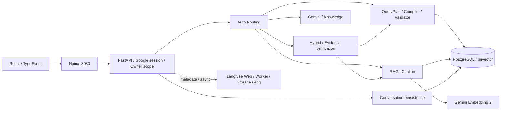

# ShopQuery AI

[](https://github.com/MinhHoang1403/Shopquery-AI/actions/workflows/ci.yml)

Trợ lý phân tích bảng dữ liệu và tài liệu bằng tiếng Việt. Người dùng tải dữ liệu vào
workspace, đặt câu hỏi và đối chiếu câu trả lời với bảng kết quả, SQL hoặc nguồn trích dẫn.
Phù hợp cho phân tích nội bộ trong các phạm vi dữ liệu và quy tắc đã được kiểm chứng;
không thay thế kiểm tra nghiệp vụ hoặc hỗ trợ mọi loại truy vấn SQL.

**Đã chuyển sang giai đoạn sử dụng và bảo trì trong phạm vi khả năng đã nghiệm thu.**

- Ứng dụng chính: [http://127.0.0.1:8080](http://127.0.0.1:8080).
- Langfuse: [http://127.0.0.1:3000](http://127.0.0.1:3000).
- Một source trên `main`, một deployment `shopquery-ai`, một project giám sát
  `shopquery-observability`. Phạm vi hiện tại là localhost, chưa nghiệm thu public/VPS.

## Khả năng chính

| Nhóm | Hành vi và giới hạn |
| --- | --- |
| Quản lý dữ liệu | Workspace riêng; CSV/XLSX thành bảng, PDF có text layer/DOCX/TXT/MD thành tài liệu. Có preview bảng; không OCR hoặc DOC cũ. File tối đa10 MB, bảng tối đa5000 dòng/30 cột theo cấu hình hiện hành. |
| Liên kết bảng | Tự phát hiện ứng viên theo khóa/metadata và kiểm toàn bộ dữ liệu trước khi kích hoạt N:1. Cặp mơ hồ không tự duyệt; UI hiển thị liên kết đã kiểm chứng. |
| SQL | Câu hỏi → typed QueryPlan → compiler → kiểm AST/quyền/grain → SELECT read-only. Bảng kết quả giữ Decimal/NULL và nguồn COUNT; có thể xem SQL. |
| RAG | Truy xuất đoạn tài liệu đúng workspace, trả lời dựa trên bằng chứng và citation. Không dùng tài liệu workspace khác. |
| Hybrid | Kết hợp dữ liệu SQL với chính sách tài liệu. Quy tắc đơn giản đủ bằng chứng được backend tính bằng Decimal; thiếu/mâu thuẫn bằng chứng phải từ chối kết luận. |
| Hội thoại | Google login, model selection, lịch sử và follow-up cùng owner/conversation/workspace; chỉ dùng tiền đề thành công, Hybrid phải verified. |
| Guest | Xem/thử dữ liệu tạm trong RAM với TTL/quota; Guest AI hiện OFF. Reload/restart không bảo toàn Guest RAM. |
| Giám sát | Langfuse ghi stages, duration, model, usage và lỗi an toàn; metadata-only, export bất đồng bộ và fail-open. |

JOIN uploaded hỗ trợ tối đa ba bảng trên cây N:1 đã duyệt; không many-to-many,
outer/self/composite joins hoặc hai fact tables. Hybrid không phải rules engine tổng quát.
Không có chức năng tải lại original document binaries hoặc export kết quả chuyên biệt
được công bố. Chi tiết: [khả năng/giới hạn](docs/capabilities.md).

## Kiến trúc



Mô tả module và các ranh giới bảo mật nằm trong [kiến trúc](docs/architecture.md).
Không có generator SQL tự do, pipeline thứ hai hoặc fallback bỏ qua guards.

## Model và cấu hình vận hành

| Cấu hình | Runtime đã nghiệm thu |
| --- | --- |
| Generation mặc định | Gemini `gemini-3.5-flash-lite` |
| Lựa chọn thủ công | iNetCloud Knowledge, model `knowledge` |
| Gemini fallback | OFF |
| Provider data gate | ON cho sử dụng thường ngày đã được operator cho phép |
| Guest AI | OFF |
| Embedding | `gemini-embedding-2`,768 chiều |
| Retrieval | Vector-only; BGE GPU chưa được nghiệm thu/bật production |
| Langfuse | Instrumentation ON, SDK 5.0.4/server 4.70.1 |

Knowledge đã có SQL JOIN/RAG/Hybrid live passes trong phạm vi synthetic, nhưng đợt
đánh giá rộng hơn còn một mẫu UNKNOWN; chưa đủ căn cứ chuyển thành mặc định.
Generation/embedding gửi dữ liệu tới provider đã chọn; chọn Knowledge không ngăn
query/document embeddings gửi text tới Google. Không tự bật fallback hoặc Guest AI.

Đợt sửa28/10/2026 đã triển khai định tuyến theo bằng chứng cần dùng, contract intent/scope
bắt buộc và thông báo dễ hiểu. AutoRAG policy-only, COUNT+SUM, SQL Khách sạn, Hybrid và
follow-up đã PASS trong phạm vi7câu mới, có cả1failure trước correction. Knowledge vẫn
manual/chưa nghiệm thu generation lại sau403/timeout. Trạng thái ứng dụng đạt trong phạm vi
đã kiểm với giới hạn upstream; xem [root causes, scorecard và giới hạn](docs/correctness_review.md).
Không suy các PASS này thành bảo đảm mọi câu hỏi/schema hoặc khả năng phục hồi của Knowledge.

## Cài đặt và vận hành

Công cụ phát triển: Git, PowerShell, Python 3.11/uv, Node 24/npm; Docker Desktop dùng
Linux containers và Compose hỗ trợ `!override`. Runtime đã có dùng release images
pin digest; không cần cài Node/Python mới để sử dụng giao diện.

Với checkout đang vận hành, giữ private `.env`, `.env.release`, hai local YAML overrides,
credentials Google/provider/Langfuse và các volumes. **Không copy template đè lên cấu hình
hiện hành.** `.env.example` là mẫu cho cài đặt mới, không có secrets và giữ paid gate OFF.
Cài mới/migration cần làm theo [authentication](docs/authentication.md) và
[deployment runbook](docs/deployment.md), không chạy seed/reset trên DB hiện có.

Kiểm tra không thay runtime, tại repository root:

```powershell
./scripts/release.ps1 -Observability
Invoke-RestMethod http://127.0.0.1:8080/api/health
docker compose -p shopquery-observability --env-file ops/langfuse/.env -f ops/langfuse/compose.yaml ps
```

Thứ tự Compose đang dùng: `compose.yaml` → `.env.compose-ui.yaml` → `.env.join-v1.yaml`
→ `compose.release.yaml` → `ops/langfuse/shopquery.compose.yaml`, đọc `.env` rồi `.env.release`.
Không chạy base Compose một mình. Tên local override có `v1` là identifier tương thích,
không phải deployment cũ có thể xóa.

Cập nhật: sửa đúng phần cần thiết → targeted tests → commit/push/CI → build riêng
service đổi application inputs → pin immutable digest/giữ rollback → operator duyệt
thời điểm gián đoạn → deploy → strict verifier và kiểm 8080. Docs/scripts không dùng
trong image không yêu cầu rebuild/redeploy. Ví dụ **chỉ sau cutover được duyệt**:

```powershell
./scripts/release.ps1 -Deploy -Service api -Observability
```

Restart an toàn phải kiểm công việc đang chạy và dùng đúng project/service trong
[runbook](docs/deployment.md#restart-và-khôi-phục); không recreate PostgreSQL/volumes.
Development/GPU là chế độ maintenance opt-in, không phải stack cần chạy thêm;
xem [development](docs/development.md).

## Bảo mật và dữ liệu

Google OIDC invite-only; sessions lưu PostgreSQL, CSRF cho mutations, repository gắn
owner/workspace trước truy cập bảng/tài liệu. SQL executor dùng reader, read-only
transaction, timeout và row cap; identifiers từ registry, values dùng bind parameters.
Giữ fact/grouping grain, COUNT provenance, Decimal/NULL và evidence coverage guards.

Không commit `.env`, keys, cookies, uploads, vectors, database dumps, weights hoặc
private logs. Langfuse không nhận raw questions/prompts/answers/SQL/rows/documents;
telemetry lỗi không được làm chatbot lỗi. DB/Redis/ClickHouse Langfuse không publish;
UI cần thiết chỉ bind loopback. [Security](docs/security.md) ghi các giới hạn trước public hosting.

## Kiểm thử và nghiệm thu

```powershell
./scripts/test.ps1 -Tests tests/test_plan_binding.py
uv run --no-project --with-requirements scripts/requirements-maintenance.txt python scripts/test_maintenance_tools.py
```

CI chính thống nhất backend lint/unit/contracts/golden/security, PostgreSQL isolated,
frontend lint/typecheck/unit/build/mock E2E, maintenance utilities và Compose isolation.
Integration test nặng chạy trên CI; không seed/reset main hoặc tạo thêm Docker test stack.

Baseline đã kiểm:1391 backend unit,857 PostgreSQL integration,85 frontend và125mock E2E
PASS tại source 3fe4cc2;10 Compose checks PASS. Đợt bàn giao thêm 10 maintenance tests.
Kết quả exact-head cuối và kiểm runtime ghi trong [bàn giao vận hành](docs/operational_handoff.md).
Tests mocks/schema/HTTP200 không tự chứng minh câu trả lời live đúng.

Sáu câu UI gần nhất: Gemini SQL, Knowledge JOIN, RAG, Hybrid, follow-up và SQL Khách sạn
đúng independent PostgreSQL oracle/tài liệu.10 generation stages và3 query embeddings,
32601 generation tokens khớp diagnostics. Không gọi lại provider khi cleanup không đổi AI logic.
Xem [nghiệm thu hệ thống](docs/v2_final_acceptance.md) và [telemetry](docs/observability_acceptance.md).

## Langfuse

Một root/correlation mỗi request, children phản ánh đúng giai đoạn thực chạy; mỗi
SDK dispatch có một generation/embedding observation. Hybrid deterministic không tạo
model call giả. Metadata an toàn ghi model, latency, trạng thái và token do SDK cung cấp.

Embedding token usage/Knowledge cost có thể UNKNOWN. Gemini cost là ước tính theo
managed list price, không phải hóa đơn. Retention tự động của edition self-host hiện tại
chưa có cơ chế được nghiệm thu; backup/restore Langfuse chưa diễn tập. Không diễn giải
UNKNOWN thành 0 hoặc synthetic trace thành full acceptance. [Runbook Langfuse](ops/langfuse/README.md).

## Tài liệu

- [Kiến trúc](docs/architecture.md), [khả năng](docs/capabilities.md), [bảo mật](docs/security.md).
- [Deployment/recovery](docs/deployment.md), [authentication/migration](docs/authentication.md).
- [Development](docs/development.md), [testing](docs/testing.md), [bộ synthetic bảo trì](docs/maintenance_tools.md).
- [Nghiệm thu](docs/v2_final_acceptance.md), [bằng chứng kỹ thuật](docs/architecture_audit.md),
  [Langfuse acceptance](docs/observability_acceptance.md), [nguồn kỹ thuật](docs/technical_references.md).
- [Bàn giao và cleanup](docs/operational_handoff.md). Đọc [AGENTS.md](AGENTS.md) trước thay đổi source.

Giữ chế độ bảo trì có kiểm soát; chưa tag/full Stage2, chưa enterprise/public-ready,
không bảo đảm mọi schema, mọi câu hỏi hoặc mọi mức tải.
