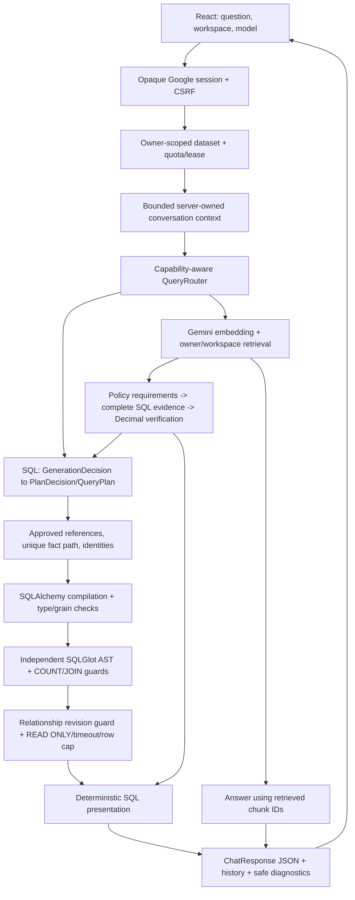

# ShopQuery AI — architecture, reliability and security audit

Runtime27/10 sau tích hợp Langfuse: API source3fe4cc2/imaged8ad8aa5, Webae181335
giữ nguyên. [Nghiệm thu observability](observability_acceptance.md) có6câu live
đúng oracle và trace/usage, không thay AI business logic hoặc promote Knowledge
như một đợt ổn định toàn diện. Các source/image bên dưới là baseline lịch sử của
đợt SQL; runtime hiện hành xem [deployment](deployment.md).

## Ổn định Knowledge SQL lần cuối — 27/10/2026

Kết luận: **KNOWLEDGE_NOT_ACCEPTED — GEMINI_PRODUCTION_READY**. Đợt sửa cuối đã triển
khai trên8080 và đóng cửa sổ agent tests. Có15/15 mẫu SQL Knowledge chấm được đúng
oracle, nhưng1 mẫu đã chọn ban đầu mất bằng chứng do lỗi bộ ghi của agent, nên chưa
đạt điều kiện mọi mẫu đã chọn đều PASS. Đây không phải một model failure đã xác nhận;
không loại mẫu UNKNOWN để tuyên bố Knowledge ổn định. Gemini default/fallbackOFF giữ
nguyên. Dừng cải tiến sau bàn giao, không mở cửa sổ thử khác hoặc release tag.

Đây là đợt hẹp cuối cùng, không mở lại audit toàn hệ thống. Baseline mainb6565d4/API67a891b0/Webae181335,
strict87modules PASS; Gemini default/fallbackOFF/gateON/GuestOFF/embedding2/768 giữ nguyên.
AGENTS.md gốc đã đọc, không có AGENTS.md con. Ba script fixture bảo trì untracked
được giữ nguyên; không dùng fixture bảo trì production chưa hoàn tất.

### Nguyên nhân được xác nhận và phần chưa biết

Actual SDK: Pydantic2.14.1, langchain-openai1.7.2/langchain-core1.6.12, OpenAI3.35.1,
google-genai1.75.0, SQLAlchemy2.1.4, SQLGlot29.0.1. MockTransport của chính SDK xác nhận
Chat Completions/modelknowledge/response_format=json_schema/strict=true/include_raw=true.
Strict serializer yêu cầu đủ14 trường; where/having chỉ là string/maxLength32, không có
predicate grammar. Validator Python không tự trở thành JSON Schema constraint. Vì vậy
các chuỗi lỗi `,having=[]}` và `,limit=0,` vẫn phù hợp kiểu JSON string trong schema cũ.
Conversion chỉ chuyển chuỗi rỗng thànhNone, không sửa chuỗi lỗi; chưa có bằng chứng SDK
tự tạo những chuỗi này. Nguyên nhân nội bộ model/serving phát sinh delimiter vẫn UNKNOWN.

Việc14 trường bắt buộc/unused sentinel gây lỗi, decoder có thực sự constrained hay không,
và giới hạn token phía server vẫn là giả thuyết. Không có quyền/log quản trị Knowledge
để kết luận. Client không đặt max_tokens; diagnostic cũ có JSON đầy đủ nên không có bằng
chứng truncation. Probe mới1stage synthetic chấp nhận đúng schema thêm pattern, parser/
domain PASS, finish_reason=stop,38873.42ms. Projection deployed có cùng type/required/
pattern constraints với probe; khác root description metadata, không byte-identical
toàn schema. Đây là compatibility evidence, không phải
chứng minh cơ chế decoder hoặc SQL acceptance. Không thay endpoint/model, không trả rawSQL.

### So sánh phương án và lựa chọn

| Tiêu chí | A: ràng buộc hợp đồng hiện có | B: wire contract mới/nullable | C: phần cơ học trong Binder |
| --- | --- | --- | --- |
|Root cause|Đưa cú pháp predicate còn thiếu vào schema|Có thể giảm sentinel, chưa chứng minh nguyên nhân|Bổ sung tên/thuộc tính phụ thuộc khóa dimension đã chọn rõ|
|Knowledge|Projection cùng GenerationDecision, thêm2pattern|Đổi representation/required/union nhiều hơn|Giảm nghĩa vụ GROUP BY cơ học của model|
|Gemini|Không đổi schema/adapter Gemini|Cần chứng minh lại SDK/native schema|Cùng Binder, oracle hai adapter bắt buộc|
|Complexity|Một schema projection trong adapter hiện có|Cao hơn, conversion/compatibility mới|Một vòng trực tiếp trên approved N:1 path|
|Security/validation|Pydantic/domain/binding vẫn quyết định; pattern không cấp quyền|Không được bỏ predicate không hiểu|Chỉ explicit target identity; không đoán category/FK grain/fact attribute|
|Regression risk|Thấp; server bỏ pattern vẫn bị local validator chặn|Lớn hơn do anyOf/nullable/sentinel|Có giới hạn; Compiler/AST/revision guard giữ nguyên|
|Compatibility|Một probe đúng schema đã PASS; offline SDK wire kiểm được|Chưa có evidence hơn A|Backend, độc lập provider và tên domain|
|Cost/latency|Không thêm call/retry, latency decoder cần đo|Chưa chứng minh lợi ích|Không thêm generation hoặc query DB|
|Rollback|API image cũ + environment trước cutover|API rollback nhưng phạm vi đổi lớn hơn|Cùng một API image rollback|

Chọn **A + phần C cơ học tối thiểu**, không chọn B, không đổi prompt theo câu hỏi,
không tạo planner thứ hai. `KnowledgeGenerationDecision` kế thừa nguyên contract và
validators, chỉ xuất pattern cho where/having trong request Knowledge. Gemini giữ nguyên
GenerationDecision/native responseSchema. Empty string vẫn là absent; predicate sai không
bị chuyển thành absent. Reference đã đúng syntax nhưng không được cấp vẫn bị Binder chặn.

`bind_approved_grain` chỉ thêm direct selected attributes vàoGROUP BY khi chính target
identity của approved N:1 dimension đã nằm trong group_by gốc. Thuộc tính phụ thuộc duy
nhất khóa ấy nên không chia thêm entity; không thêm measure/count/filter. Thiếu identity,
FK grain, category, fact attribute hoặc biểu thức không xác minh vẫn refusal như trước.
Compiler gọi trực tiếp vẫn từ chối projection_grain; execution guard vẫn recheck quan hệ.

### Before/after và regression

Ba regression mới FAIL trước sửa:2 predicate wire constraints thiếu,1 selected dimension
attribute thiếuGROUP BY. Negative counterparts không được đổi thành query đoán mò.
Tests đã thêm cả server-bypass/local refusal, Gemini schema isolation và24 PostgreSQL
oracle cases trên6 domain/hai adapters, có filters+WHERE+HAVING phân biệt nhau.
Missing/conflicting outcome, issued IDs/relations, expressions/forward refs, literals,
aggregate/type/grain/COUNT provenance, category/entity, missing data, two-fact/fanout,
cross-owner/injection, coverage/context/follow-up và error taxonomy vẫn bị kiểm đúng.
Không biến SQL validation refusal thành fallback. Các tests fallback giữ attribution,
503/timeout, schema/conversion category, no-loop và chỉ reuse embedding trong cùng turn.
Không tạo provider outage thật để kiểm fallback trả phí.

Targeted217 PASS, Ruff PASS. Exact application/test main
`a67242d1e6a1e267c440eeb6547c7ddbd961fb9a`,
[CI40441018076](https://github.com/MinhHoang1403/Shopquery-AI/actions/runs/40441018076)
PASS hai job được yêu cầu:1365 backend và857 PostgreSQL isolated. Frontend job SKIPPED
vì không đổi Web; không dùng lịch sử85frontend làm kết quả mới. Lượt CI đầu833PG PASS,
24 test mới lỗi StopIteration do fixture cố ý đảo thứ tự upload; sửa resolver test theo
registered display names, không đổi code/guards/oracle để làm xanh. CI cuối24/24 mới PASS.

Production chỉ sửa `ai/inetcloud.py::_predicate_schema`, `KnowledgeGenerationDecision`,
`InetCloudGateway.generate_structured` và `text_to_sql/plan_binding.py::bind_approved_grain`.
Regression chính thức trong test_plan_providers, test_plan_binding,
test_plan_binding_integration, test_compiler_diagnostics và test_planning_outcomes.
Không đổi Gemini adapter, shared generation DTO, prompt, Compiler/Executor, RAG/Hybrid,
embedding hoặc auth. Compiled SQL vẫn qua AST/read-only/owner/revision/timeout/row cap;
WHERE/HAVING/filters giữ nguyên, NULL không biến thành0. Không raw SQL/JSON repair.

### Knowledge scorecard live và giới hạn bằng chứng

Chốt18 mẫu trước SQL dispatch:15 Knowledge SQL,1 Gemini compatibility,1 RAG,1 Hybrid.
Sau sự cố ghi bằng chứng ở COUNT, thêm đúng1 biến thể COUNT độc lập trước khi thấy bất
kỳ kết quả SQL chấm được; không thay/xóa câu gốc. Selection hashes và amendment giữ trong
private evidence. Tổng19 mẫu, trong đó16 Knowledge SQL;15 PASS và1 UNKNOWN. Mỗi câu chỉ
gửi một lần.13 SQL Knowledge dùng production pipeline thực trong API container;2 câu
SQL qua Computer Use/UI8080. Không gọi pipeline là browser test. Router tự chọn route,
Knowledge attribution được kiểm, không Gemini fallback. Oracle PostgreSQL READ ONLY
độc lập đã tính trước dispatch, không đưa expected rows vào model prompt.

| Mẫu | Kết quả so với oracle |
| --- | --- |
| k01 COUNT Xe điện, câu gốc | UNKNOWN_INSTRUMENTATION; không chấm PASS/FAIL model |
| k02 SUM Xe điện | PASS33066538.03 |
| k03 COUNT+SUM | PASS360 /33066538.03 |
| k04 theo trạm, lỗi lịch sử | PASS12 trạm,1JOIN, đúng từng count/total |
| k05 theo gói | PASS5 gói,1JOIN, đúng tên/count/total |
| k06 SUM Khách sạn | PASS638885507.75 |
| k07 số phòng>100 | PASS16 mã/tên; không mất WHERE |
| k08 nhóm trạng thái | PASS4 nhóm, tổng2400 lượt |
| k09 theo khách sạn | PASS24 khách sạn,1JOIN, count/Decimal totals đúng |
| k10 khu vực × nhóm phòng | PASS12 nhóm,2JOIN;2400 /638885507.75 |
| k11 trạm × gói | PASS60 cặp mã/tên,2JOIN, count/total đúng |
| k12 Logistics qua tài xế/kho | PASS5 kho,2JOIN;50 đơn /2472500.00 |
| k13 AVG | PASS91851.494527777778 |
| ui-k14 biến thể trạm | PASS12 trạm qua8080; SQL/rows/attribution persisted |
| ui-k15 biến thể phòng>100 | PASS16 khách sạn qua8080; reload/history PASS |
| k01b COUNT diễn đạt độc lập | PASS360; không thay thế kết quả UNKNOWN của k01 |
| Gemini compatibility | PASS12 trạm/1JOIN, đúng count/SUM,2 stages |
| Knowledge RAG smoke | PASS1 query embedding, citation23,2800000VND/mọi trạng thái/mã trạm |
| Knowledge Hybrid smoke | PASS1 query embedding,12 Decimal totals, verified_classification, citation23; TS07–12 đạt/TS01–06 chưa đạt |

Ở15 SQL Knowledge chấm được: false refusal0, wire/domain/binding/compiler/execution
failure0, wrong accepted rows0, unsafe/cross-owner acceptance quan sát được0. Mẫu k01
không có dữ liệu đủ để điền các chỉ số đó; không suy từ HTTP200/compile thành correctness.
Live plans chấm được đã tự group đủ; số thuộc tính Binder thêm trong các mẫu này là0.
Lợi ích completion được chứng minh bằng failing reproduction và PostgreSQL regression,
không nhận toàn bộ improvement live là do Binder. Latency end-to-end SQL Knowledge
n=15: min5362.53ms, median8519.85ms, max15297.43ms; không phải load/SLA/p95 benchmark.
Follow-up không gọi lại live trong đợt hẹp; regression offline/PG PASS, bằng chứng UI
26/10 vẫn là lịch sử, không cộng vào score mới.

Sự cố k01 thuộc private audit recorder: `dataclasses.asdict(CountMetric)` giữ SQLGlot
`Count` AST nên `json.dumps(report)` lỗi sau capture compiler; raw rows/response không
được lưu. Không có bằng chứng sản phẩm/provider lỗi ở lượt đó. Sửa riêng recorder thành
primitive count metadata; không sửa model payload, không gửi lại câu gốc, không hoàn trả
budget. Phiên nghiệm thu kết thúc với1 UNKNOWN nên không chuyển Knowledge default.
Không kết luận phải thay server/model chỉ từ sự cố này. Phía server vẫn UNKNOWN về
decoder/nguồn delimiter lịch sử; cần serving logs mới nếu người vận hành mở nhiệm vụ khác.

Budget MỚI Knowledge40/Gemini5 generation,8query/0document embeddings. Đã quan sát
34 Knowledge stages và2 Gemini stages; giữ thêm2 Knowledge debit bảo thủ cho k01 chưa
đủ log, tổng tính36/40 và2/5. Query2/8, document0/0. Reservation không hoàn lại40/2/4/0;
ledger đã đóng, không dùng dư hay gọi thêm. Không cộng token chưa biết của k01 và
không suy số tiền từ token.
Token SDK ghi nhận101956input/15772output cho các ca hoàn tất, thêm probe228/1020:
**102184input +16792output =118976total**; k01 token UNKNOWN, billed cost UNKNOWN.

### Runtime cuối và đóng băng

API-only cutover27/10/2026 10:00:55–10:01:11 Asia/Saigon, source/test maina67242d ở
trên, immutable image
`sha256:069e7f67fb409ac3a587c6327104f509bf3182ca2d410e281f2f3cf90818c599`.
API container3ce1af0d; Webc6f1f591/source02d5cbb/image
`sha256:ae181335b61aa738f6b0b1c2c1c450fe46a5ba26b4688d5c294d541975696a58`
không rebuild/recreate. Strict87modules PASS cuối, no source/config drift, Nginx syntax/
graceful reload/health8080 PASS. Documentation-only commits sau đó không đổi application
bytes nên không rebuild/redeploy. Main DB511c4f5a/protected volume/image/start time giữ
nguyên trong nhiệm vụ này; không migrate/reset. Không xóa image/volume/prune/project khác.

Final fingerprints40tables/schema PASS; chỉ thay resource_limits,users,user_sessions
do đăng nhập/quota và thêm2conversations/4messages UI. Old history prefix giữ nguyên;
datasets/tables/documents/chunks/vectors/approved relationships không đổi. Google login,
workspace/history/reload được kiểm qua8080. Không xác nhận uptime liên tục trước nhiệm vụ.
Rollback API67a891b0/sourcef6f44ae và `.env.release.before` giữ ngoài Git tại private
backups/shopquery-ai/knowledge-final-20261027. Ba script fixture bảo trì của operator
vẫn untracked; không xóa/commit. Private harness/logs ngoài repository không phải source
production; không tạo thử nghiệm tạm còn sót trong repo.

Final: Gemini default `gemini-3.5-flash-lite`, fallbackOFF, gateON, GuestOFF,
`gemini-embedding-2`/768, vector-only/noBGE. Knowledge `knowledge` vẫn chọn thủ công được;
không hứa ổn định mọi SQL hoặc mọi dataset. Không cần sửa code tiếp khi chưa có failing
test/evidence mới. **KNOWLEDGE_NOT_ACCEPTED — GEMINI_PRODUCTION_READY**, phạm vi demo
Gemini đã công bố giữ nguyên; không Full Stage2/BGE PASS, không tag, dừng phát triển.

Nguồn kỹ thuật: [Pydantic JSON Schema](https://pydantic.dev/docs/validation/latest/concepts/json_schema/),
[LangChain structured output](https://reference.langchain.com/python/langchain-openai/chat_models/base/ChatOpenAI/with_structured_output),
[OpenAI schema subset](https://developers.openai.com/api/docs/guides/structured-outputs).
Spec OpenAI không tự chứng minh Knowledge server thực thi cùng decoder; installed SDK
serialization và live conformance được đối chiếu riêng.

## Audit gốc 26/10/2026 — bằng chứng lịch sử

Audit date: 26/10/2026, Asia/Saigon. This is the current report, updated in place.
Recommendation: **DEMO_READY_WITH_LIMITATIONS using Gemini**. Audit changes are deployed
on8080 and the bounded acceptance is complete. Knowledge SQL is NOT accepted; no universal
correctness, BGE, Stage2/full-release PASS or release tag is claimed.

## Scope, authorization and baseline

Root AGENTS.md read; no nested AGENTS.md found. One main source and one production
deployment on8080. User authorizes bounded offline/live audit and conditional deployment,
200 logical generation stages,100 query embeddings,30 fixture document embeddings for the
entire audit. No previous window reused. Private cumulative ledger is outside Git under
`architecture-audit-20261026/usage-ledger.json`; every dispatch is reserved before sending.
Concurrency, SDK one-attempt policy, provider isolation, Gemini default, fallbackOFF,
gateON/GuestOFF, embedding2/768 and vector-only retrieval remain unchanged.

Initial main9269dc91; application08d71b9020; API2be8945280db / Web03f83efc5f4b.
Strict87modules PASS, no source/config drift. Main PostgreSQL511c4f5a and protected
volume `shopquery-ai_postgres_auth_20261019` healthy, never recreated.40table logical
fingerprints/schema fingerprint, history/session rows, images, source, sanitized Compose
fingerprint and rollback refs captured privately before architecture changes. No secrets,
raw plans/provider JSON or personal rows are committed. Untracked maintenance work is
excluded. Existing sessions/history reload confirmed through Computer Use.

## A. Docker synchronization and cleanup

Actual container references, RepoDigests, tags and OCI revisions checked rather than tag
names alone. No runtime rebuild was needed for baseline synchronization. Only12 obsolete
ShopQuery image manifests were removed, by individually reviewed tags without force:

| Image prefix | Kind | Former source prefix |
| --- | --- | --- |
|1a57c0d15194|API|5ba7669|
|26877f4176df|API|5d4c595|
|5bc66e195142|API|f90592d|
|5db99157ab74|API|a49d4eb|
|5f4ab329c750|Web|881bfe1|
|626a8704c2ba|API|b48cfc2|
|da01d59e8e4d|Web|0656765|
|de4bf4c27fab|API|3364da4|
|df8dff610cd9|API|df10688|
|f161d7f5a441|API, two tags|ac36973|
|fbfeb03fd137|API|e49f838|
|fec296b45cff|Web|df10688|

Kept active API2be89452/Web03f83efc and immediate compatible rollback
API6994abd7/source0656765, Web127da3e8/sourcefd1f510. Historical rollback references
in older report sections are archival; these two are the current rollback pair. All
foreign image IDs and images referenced by running/stopped containers were preserved.
No container, volume, global cache or other project was cleaned. No physical-space
recovery claim: shared layers/cache prevent independent attribution. After cleanup
8080health, runtime identity and strict verifier passed, no API/Web/DB recreate.

After the verified follow-up correction, unused API candidate `a5ef0c867d66` was also
removed by its exact tag, with no container/current-config references and no force.
The final active pair is API67a891b0/Webae181335; immediate rollback is the former
active API2be89452/Web03f83efc, both retained with the pre-cutover private environment.
Earlier compatible API6994abd7/Web127da3e8 remain retained as additional history.

## B. Architecture and contracts

| Boundary/modules | Input → output; authority and invariant | Failure / regression |
| --- | --- | --- |
|frontend App/auth/api|UI selection → CSRF-authenticated request; UI never authorizes SQL|auth mock E2E, App tests|
|auth dependencies/oidc/repository|opaque session → invited Principal; state/nonce/PKCE/signature/expiry verified by Authlib; no caller owner ID|401/403; auth and auth integration|
|api routes/resource limits|Principal+dataset → owner repository/context; provider gate and lease before paid work|quota/CSRF/owner guards; management/auth tests|
|datasets parser/repository|bounded file → typed ParsedTable → atomic DDL+rows+registry; source headers retained, formula text never executed|UploadValidationError; parser/import integration|
|relationships detection/repository|registry+full data proof → approved revision N:1; names and values alone insufficient; execution rechecks revision|ambiguous/orphan/NULL/duplicate refusal; relationship tests|
|conversations/context|same owner/conversation/dataset successful snapshot → bounded untrusted reference context; Hybrid only verified classification|unverified/error/owner mismatch clears premise; verified conversation tests|
|routing/router/service|available sources+question → SQL/RAG/HYBRID/UNSUPPORTED; route is a proposal, not authorization|route unavailability never grants missing capability; routing tests|
|ai adapters|schema+prompt → bounded Pydantic wire/domain types; configured endpoint/model only|transport/schema/wire/conversion distinct; SDK mock transports|
|query_plan/generation_contract|one outcome+flat DAG → one internal typed QueryPlan;80nodes/depth8/expanded512; sentinel0/empty only in wire|typed conversion/outcome/predicate errors; contract tests|
|plan_binding|issued references → unique approved fact path and entity identities; no fuzzy remap|unknown source/ref/rel/ambiguous grain; binding tests|
|compiler/expressions|authorized plan → parameterized SQL+provenance+presentation metadata; no model SQL; exact numeric/temporal types|safe compiler branch codes; compiler/property tests|
|validator/count_contract/join_policy|SQL AST → ValidatedSql; independent SELECT/function/schema/COUNT/fact/N:1/grouping guards|unsupported/safety refusal; negative/golden tests|
|executor/relationship guard|ValidatedSql+bound params → ≤200 JSON-safe rows; READ ONLY, local timeout/timezone, rollback|SqlExecutionError; timeout/permission/Decimal integration|
|rag parser/chunker/repository|bounded docs → scoped chunks/vectors; duplicate detection; no OCR/code execution; atomic persistence after embeddings|parser/storage/owner integration|
|rag pipeline|query → embedding/retrieved chunks → answer with only supplied chunk IDs|invalid/missing citation refused; general prose semantics not deterministic proof|
|hybrid policy/binding/coverage/evidence|whole verified source+closed rule+complete SQL → Decimal verdict; freshness/source/identity/unit/count verified|ambiguous/multiple/incomplete evidence refusal; Hybrid negative integration|
|answer/API/history|structured rows+compiled metadata → lossless summary/inline/detail + JSON metadata|no extra AI; no units inferred from alias; presentation/history tests|
|diagnostics/release|bounded request facts → correlations/stages/branches/usage; immutable images → one8080 deployment|no raw content in diagnostics; strict verifier/rollback|

Repositories with setup privileges handle authenticated ingestion/persistence; the model
never receives those privileges. The SQL reader can read uploaded tables across owners
at the database-role level, so application authorization/catalog isolation is a real
security boundary, not claimed PostgreSQL row-level security. Guest uses a separate
NOLOGIN role and temporary tables. Default demo corpus is distinct from user workspaces.

### Capability matrix from implementation

| Capability | Status | Conditions / explicit exclusions |
| --- | --- | --- |
|single-table SELECT/COUNT/SUM/AVG/MIN/MAX|SUPPORTED|authorized registry/types/AST; SUM/AVG numeric; COUNT provenance|
|Decimal/NULL/zero/large integers|SUPPORTED|exact strings for NUMERIC/unsafe integers; no float money or NULL→zero|
|typed comparisons/AND/OR/date ranges|SUPPORTED|type/arity checked; timezone-aware boundaries; no free SQL predicates|
|entity GROUP BY|CONDITIONALLY_SUPPORTED|projected nonaggregates grouped; approved dimension IDs retained|
|category GROUP BY|CONDITIONALLY_SUPPORTED|direct non-identity columns; exact projection/group partition; no injected entity IDs|
|sort/LIMIT/top-N/HAVING|CONDITIONALLY_SUPPORTED|within grain; SUM HAVING subset; cap200 remains; no KPI scope trimming|
|two/three-table JOIN|CONDITIONALLY_SUPPORTED|one/two approved revision N:1 edges, root fact; chain/star only|
|JOIN measures/counts|CONDITIONALLY_SUPPORTED|direct root SUM/AVG and counts; no dimension measures/fanout|
|multiple paths/two fact/composite/self/outer/four uploaded tables|UNSUPPORTED|safe refusal; no arbitrary path choice|
|CTE/subquery/window/writes/catalog/unknown functions|UNSUPPORTED|independent AST guards and reader permissions|
|MD/TXT/DOCX/text-layer PDF|SUPPORTED|upload/expanded archive/page/text limits; no OCR/legacyDOC/macros/URL ingestion|
|vector retrieval/768dims/citations|CONDITIONALLY_SUPPORTED|configured Gemini embedding, scoped owner/dataset; IDs must be retrieved|
|RAG missing/conflicting prose|CONDITIONALLY_SUPPORTED|answer may describe insufficiency/conflict; citation-ID checks do not prove all prose claims|
|RAG follow-up|CONDITIONALLY_SUPPORTED|bounded same-workspace successful reference context, fresh retrieval; no inferred missing facts|
|simple Hybrid KPI/threshold|CONDITIONALLY_SUPPORTED|one whole-source verified numeric rule, source/metric/aggregate/unit/identity bound; Decimal evaluation|
|Hybrid full coverage/freshness|SUPPORTED|two independent coverage checks plus execution result completeness/revision; no WHERE/HAVING/LIMIT exclusion|
|verified conversational classification|CONDITIONALLY_SUPPORTED|server persistence of verified_classification, same owner/conversation/dataset; fresh evidence|
|multiple rules/exceptions/ambiguous policies|UNSUPPORTED|closed grammar, fail closed; no model-generated authoritative verdict|
|BGE reranking in current runtime|UNSUPPORTED|vector-only retained; no benchmark/quality claim|

## C. Findings and root causes

| Severity | Confirmed evidence | Correction / disposition |
| --- | --- | --- |
|HIGH|pypdf6.20.1 has seven published parsing/resource advisories, certifi2026.7.22 revoked-CA advisory|lockfile pypdf6.21.2/certifi2026.10.23; existing allowed ranges; source advisories below; parser/TLS regressions required|
|MEDIUM|npm audit: undici8.11.2 has high DoS advisory via dev jsdom; not shipped in static Web|compatible transitive8.12.3 lock update; no npm force; audit now0|
|MEDIUM|captured NEW Knowledge plan selects station name but groups only station ID; compiler line283 rejects projection grain|keep refusal; code projection_grain, explain all projected nonaggregate attributes in Planner contract; no automatic grouping coercion|
|MEDIUM|same captured NEW plan has malformed where/having strings; wire/domain accepted shape and Binder ignored these fields|predicate_reference validators and bounded field lengths; Binder includes both references; no JSON repair|
|MEDIUM|compiler generic KeyError/ValueError/TypeError and direct raises lost exact failing invariant|safe allowlisted codes for projection/expression/types/clauses/literals/provenance; no raw exception logging|
|MEDIUM|CSV list(reader) materializes every row before row-cap check; failing bounded-reader test proves overconsumption|stream parsed records, stop at max_rows+1; preserve malformed-CSV translation and original limits|
|MEDIUM|`hybrid_coverage.classification_selection()` required the Vietnamese question word `nào`; natural follow-up `Vậy còn những kho chưa đạt KPI?` missed full coverage and persisted unverified|one additional full-match pattern for `vậy còn … đạt/chưa đạt`;3 positive tests failed before/4 qualifier-injection negatives passed, then128 related tests PASS; real persisted follow-up and live oracle proof below|
|MEDIUM|full baseline suite16failures: tests still expected nested provider PlanDecision, wire-only semantic acceptance, AI SQL grounding|updated assertions to current production classes/contracts and deterministic presentation; keep negative cases; no production behavior rollback|
|LOW|provider usage facts absent in request diagnostics; repeated paid diagnostics needed historically|bounded logical generation/query/document counters and safe numeric SDK token metadata in existing trace; absent tokens stay unknown|
|LOW|embedding response checked dimensions but not finite values|reject NaN/Inf before vector repository; negative regression|

Original JOIN correlation `f93ddf2487a14353a848acfbba5bd457`:
**ORIGINAL_PLAN_UNAVAILABLE**. Confirmed original stage remains plan_compilation before
execution, exact original invariant UNKNOWN. One separately authorized audit diagnostic
(one Knowledge stage, no SQL execution) captured a new equivalent failure at actual
`QueryCompiler._compile` projection-grain raise. Its malformed predicates are a second
independent issue in that new response. Never claim this reconstructs the old JSON.

The reconstructed valid counterpart groups both approved ID and selected name and
compiles through unchanged JOIN/count/AST guards. Invalid counterpart stays refused with
stable code; malformed predicate cannot be treated as absence. Four focused tests failed
before these corrections. All supported-domain semantic authorizations remain in backend.

Postdeploy Knowledge JOIN correlation `5b518ea2ecb74b78b37f5913e5f6e938` is a distinct
failure: `sql_plan_generation / wire_validation / predicate_reference`, location `where`.
The new boundary rejects malformed predicates before binding/compilation/execution.
Two generation stages, no embedding, retry or fallback. This demonstrates safe refusal,
**not** repaired Knowledge planning. Remaining Knowledge SQL samples were not dispatched;
no additional prompt, schema coercion or paid repair loop was attempted.

No new compiler/provider schema family/service/framework was introduced. Prompt change
is two sentences explaining a proven missing GROUP BY obligation, not a new NLU grammar.
Legacy SQL-only dataset context forbids categories but is not transmitted by current
uploaded Planner/Router; retained, marked as documentation debt, not blamed for live errors.

## D. Test strategy and golden regression

Full offline suite is used in this audit, rather than previous repair-only CI selection.
Baseline:1268PASS/16FAIL/841deselected. The expanded PostgreSQL run initially exposed
265 failures, mostly stale assertions; it also exposed the real missing follow-up grammar
case above. Final complete CI on main/test `272cbf81a01ce774eb1805762fe2908b3c558aed`
is [40303628357](https://github.com/MinhHoang1403/Shopquery-AI/actions/runs/40303628357),3/3 PASS:

- Backend1349PASS/849deselected, Ruff PASS.
- Isolated PostgreSQL833PASS/1365deselected, including8 added metamorphic cases.
- Frontend85unit PASS, lint/typecheck/build PASS,125 offline browser cases PASS across
  1440/1280/768/390/320 viewports. No claims of provider live success from these mocks.

The last test-only commit corrects an unordered PostgreSQL GROUP BY expectation; it does
not change application bytes or require another image build. The128 related local checks
overlap the complete backend suite and are not added to its unique-test count.

Existing tests are consolidated with `reliability_golden` marker in conftest; no duplicated
business-rule framework. Run `pytest -m "reliability_golden and not integration and not live"`.
Database side uses the same marker with `integration`, CI-isolated PostgreSQL only.

| Failure class | Minimal production-path regression | Expected outcome/stage |
| --- | --- | --- |
|Knowledge503|test_providers/error_contract|provider transient/request, no SQL, eligible fallback only by policy|
|wire/outcome/conversion|generation_contract/contract_conversion|invalid shape wire_validation; typed domain branch; one call|
|unknown source/ref/relationship|plan_binding/plan_security|binding refused, no nearest-column remap|
|missing projection grouping / Knowledge JOIN|compiler_diagnostics|projection_grain at compilation; valid grouped counterpart accepted|
|category false entity expansion / row cap|category_grouping/category_results_integration|12partition groups/oracle; no IDs injected; cap unchanged|
|numeric>100|category_results_integration/reliability_properties_integration|strict boundary, no JOIN; independent numeric oracle|
|COUNT/null/fact grain|count_conformance|row_count distinct from non-NULL count; dimension/fanout refused|
|incomplete KPI WHERE/HAVING/LIMIT|evidence_coverage/hybrid_evidence_integration|coverage refusal before execution; full counterpart verified|
|unverified/cross-owner follow-up|verified_conversation_contract/conversation_context|untrusted premise not reused; current evidence required|
|citation/owner mismatch|document_upload_integration/hybrid_evidence_integration|no cross-workspace evidence; citation IDs tied to retrieved set|
|Decimal/NULL/presentation/history|decimal_contract/result_presentation|exact JSON/formatting, no added generation, metadata persists|

Added49 seeded unit property cases: catalog permutation/ref-ID stability, aliases do not
change provenance, malformed predicates never repaired, unknown authority remains refused.
Added8 isolated PostgreSQL metamorphic fixtures: source-row permutations, category partition,
exact Decimal sums, NULL/value-count difference, > vs>=100, bounded READ ONLY oracle.
Existing chain/star/context permutation tests cover N:1 no-fanout, multilingual domains,
time boundaries, owner/workspace mutation and policy/citation negatives. No Hypothesis
dependency needed for these bounded replayable invariants; not an exhaustive fuzzing claim.

### Security checks and limits of the evidence

| Boundary / threat | Concrete protection and regression evidence | Residual limitation |
| --- | --- | --- |
|Cross-owner table/document/history access|Scoped repositories and catalog; foreign conversation/dataset returns404; FK ownership and reader-denial integration|Shared uploaded-data reader role is not PostgreSQL RLS; catalog authorization must remain mandatory|
|Model SQL injection / excessive agency|Provider emits typed references, not SQL; bound literals; independent SELECT/function/schema/COUNT/JOIN AST validation; reader READ ONLY|A schema-valid proposal can still be semantically wrong; sample oracle checks are necessary|
|Document/cell prompt injection|Untrusted evidence wording, retrieved-ID citations, backend policy grammar and arithmetic; arbitrary instructions cannot grant references/SQL privileges|General RAG prose correctness is not fully verified by citation identity alone|
|Session/CSRF/OIDC|Opaque sessions; invite principal; CSRF required for authenticated writes; OIDC state/nonce/PKCE/signature/expiry checks; auth tests|Real second-account operator acceptance is distinct from isolated two-owner fixtures|
|Upload resource exhaustion|Input/expanded ZIP/page/text/row/column limits; streamed CSV stops after limit; parsing advisories patched|No adversarial production load or BGE stress benchmark performed|
|Malicious numeric/vector output|Decimal preservation, browser-safe integer serialization, embedding dimensions and finite-value checks|No claim of arbitrary floating-point equivalence or corpus retrieval quality|
|Provider cost/availability|Production quotas/leases, one SDK attempt, fallbackOFF/GuestOFF, cumulative pre-dispatch audit reservations|Normal-operation gate remainsON; provider availability cannot be guaranteed by local code|
|Diagnostic disclosure|Allowlisted compiler branches, bounded Pydantic loc/type and numeric SDK usage; no question/SQL/cell/raw provider JSON in events|Private captured plans and oracle rows are kept outside Git, not attached to public reports|

Full PostgreSQL regression exposed stale assertions about model SQL narration, automatic
relationship counts, identity columns and deterministic Vietnamese verdicts. They were
corrected against independent rows rather than by weakening runtime guards. The old
contradictory-model-verdict fixture expected a provider call that the verified-policy path
deliberately avoids; it now asserts no such call. Contradictory-draft rejection remains
covered by `test_hybrid_answer_consistency` and evidence-negative tests.

The original verbose KPI request does not match the closed complete-coverage request
grammar: its result remains `unverified` for conversation reuse, even when its policy
arithmetic is valid. A separate real-PostgreSQL conversation test checks the supported
complete-coverage request, canonical `entity_id`/`metric_value` evidence, persisted
`verified_classification`, fresh follow-up retrieval and cross-owner denial. Context length
limits and metadata trust remain unchanged. Only the independently reproduced elliptical
follow-up grammar omission was corrected; extra date/filter/limit/instruction clauses still
fail the full-match requirement.

Dependency evidence: base Python and npm audits report0 known vulnerabilities after the
compatible lockfile patches. An offline, read-only/network-none utility inspected the
actual final API image without starting a server or connecting to DB:118 distributions,
116 recognized by pip-audit,0 known findings. The private application is not a PyPI package;
`torch2.14.1+cu130` is not recognized as that exact distribution. A separate advisory lookup
for upstream `torch2.14.1` reports0 known findings; this is not certification of the CUDA
binary, operating-system packages or absence of undisclosed vulnerabilities.

## E. Provider scorecards and paid ledger

Live acceptance uses the existing synthetic datasets15/16 and already-stored documents.
Twelve postdeploy cases ran the actual scoped production pipeline in the active API
container, without conversation persistence; four further cases were sent once through
Computer Use on8080 and checked through real conversation persistence. These are different
evidence levels: the first12 do not claim browser/authentication coverage by themselves.
Independent PostgreSQL oracles run READ ONLY with timeout5s, no setup DDL/DML. No additional
fixtures, uploads, document embeddings, hidden browser requests or fake Google users.

| Provider / function | Bounded postdeploy result | Actual evidence |
| --- | --- | --- |
|Gemini SQL|5/5 correct|COUNT/SUM360/33066538.03; AVG91851.494527777778; strict>100 filter16 hotel IDs;3-table category12 groups/2400/638885507.75;2-table station JOIN12 exact groups|
|Knowledge SQL|0/1, safe refusal|Supported JOIN question, invalid `where` predicate; no SQL execution; remaining COUNT/AVG/filter/category samples NOT_RUN after blocker|
|Gemini RAG|3/3 core answers match|MD threshold/all statuses; DOCX cancelled rows retained; PDF stored fee formula/reference-price exclusion|
|Knowledge RAG|3/3 core answers match|Same3 document formats, source content/chunk identity checked; unnecessary currency/status examples in MD answer noted as elaboration beyond its minimal rule|
|Gemini Hybrid/follow-up UI|2/2 verified|One same conversation;12 exact Decimal totals, TS07–TS12 qualified/TS01–TS06 not qualified;follow-up displays only6 after verifying all12|
|Knowledge Hybrid/follow-up UI|2/2 verified|Separate same-provider conversation, same oracle/citation23; backend verified policy supplies plan and verdict, not the failing model SQL planner|

Both Hybrid pairs persist `verified_classification`, use fresh retrieval/SQL, retain exact
citation23 content and survive reload. Full SQL evidence stays12 rows; follow-up selection
uses `answer_row_indices` after verification. Google session remains valid, saved citation
expands correctly, and the composer was returned to Gemini without another generation.

| Scorecard | Gemini | Knowledge | Interpretation |
| --- | --- | --- | --- |
|Supported SQL correct / false refusal|5/5;0/5|0/1;1/1|Small labeled sample, not population accuracy|
|Wire/conversion failures|0/10 postdeploy requests|1/6 postdeploy requests|Knowledge failure is wire validation, not HTTP503 or backend SQL execution|
|Compiler/executor failures observed|0|0|Knowledge refused case never reached either stage|
|Wrong numeric answer / unsafe SQL acceptance observed|0 /0|0 /0|Refusal is counted separately; no general security guarantee|
|RAG labeled citation precision|4/4 citation uses|5/5 citation uses|Expected retrieved chunks for the3 labeled questions; not exhaustive claim-level entailment or retrieval recall|
|Hybrid verified classification / follow-up|2/2;1/1 follow-up|2/2;1/1 follow-up|Exact policy/oracle and persisted metadata; one unconditional rule only|
|SDK generation / query embeddings|18 /5|10 /5|Postdeploy only; one earlier Knowledge diagnostic adds1 generation|
|Sample p50 request latency|3250.64ms,N=10|7802.60ms,N=6|Knowledge includes its refused request; too few samples for a useful p95/SLO|
|Fallback|OFF;0 calls|OFF;0 calls|Full offline provider/security suite PASS; no live fallback activation or default promotion|
|Security/runtime|Offline owner/CSRF/AST/read-only negatives PASS; current health/strict/integrity PASS|Same backend guards|No new real second-account attack, load test, BGE/GPU benchmark or availability guarantee|

Cumulative actual audit usage: **29 generation stages,10 query embeddings,0 document
embeddings**, including the one prepatch Knowledge diagnostic. Conservative non-reusable
reservations debit65/16/0 against the single approved200/100/30 budget; unused reservations
were not refunded or used for retries. Each SDK operation has1 attempt;0 retries/fallbacks.
Postdeploy generation SDK metadata sums70842 input/5618 output/76460 total tokens across16
requests. This excludes the earlier diagnostic and embedding token usage not supplied by
these adapters. No money estimate is asserted. Agent testing is closed; the normal-operation
provider gate remainsON as requested. No old test window was reused.

## F–H. Integrity, limitations and release recommendation

Main DB DDL/DML is not used for oracle tests. Existing approved synthetic dataset15/16
may be read with owner-scoped context; controlled chat history/resource-limit writes are
expected during live acceptance. No corpus re-embedding, relationship edits, session reset,
auth weakening, BGE load or other project changes. CI DB is isolated and disposable.

General RAG prose is grounded by retrieval/citation constraints but not a deterministic
theorem prover. Hybrid grammar intentionally narrow. Model semantic correctness is not
guaranteed by schema validation: unsupported or malformed proposals must be rejected.
Zero-fact entity classification remains conditional on complete evidence guards; INNER
JOIN does not synthesize missing entities. No general enterprise availability/load claim.
Small samples do not support universal accuracy or reliable population p95 estimates.

Controlled API/Web cutover on26/10/2026,17:03 Vietnam time, after exact-head CI and active
lease/Guest-worker/input/rollback checks. No DB operation in the cutover. Current provenance:

| Component | Verified immutable identity |
| --- | --- |
|API application revision|`f6f44ae55745e8451ff5b458b98e384ac139bc9f`|
|API image|`sha256:67a891b04fcd0f0a9d6e6e7eea6bf6bccc2b3f0e72bec23be5a8c57f871d9a5a`|
|Web application revision|`02d5cbb445901f7eb63f82bee87e2e8785d35663`|
|Web image|`sha256:ae181335b61aa738f6b0b1c2c1c450fe46a5ba26b4688d5c294d541975696a58`|
|API/Web containers|`8569f0b17e6e` / `c6f1f5917f04`|
|Main DB container/image|`511c4f5aaccc` / `sha256:137f044b0efe3d57f39b972b9b53641b1f2045b99d879e298bbf514a25787dcf`|

Later test/report commits do not change the corresponding image build inputs. Strict
verifier87 modules PASS, source/config/image consistency PASS, Nginx syntax/graceful reload
PASS, Web and API through8080 HTTP200. Sample API memory219.6MiB/Web13.0MiB/DB75.2MiB;
OOMKilled false. One API worker, no reload/source mount/GPU request/model load. Gemini
default, Knowledge backend/model, Gemini embedding2/768, gateON/GuestOFF/fallbackOFF retained.

Final40-table fingerprints and schema hash match the checkpoint except expected new chat
messages/conversations and resource-limit writes. All pre-audit messages are byte-identical;
business rows, document text/vectors, approved relationships, users and sessions unchanged.
Two test conversations/eight messages were added; no existing workspace was changed.

Runtime caveat: DB StartedAt advanced from06:42:52UTC at checkpoint to09:11:16UTC, before
the10:03UTC API/Web cutover. DB logs show interruption, automatic WAL recovery and readiness
at09:11:26UTC. Container/image/protected volume identity and final data fingerprints remain
unchanged. Cause of that earlier interruption is UNKNOWN; do not claim continuous uptime
or attribute it to an OOM/provider/application defect without host evidence. The controlled
deployment itself uses `--no-deps` and did not recreate/restart PostgreSQL.

Recommendation: **DEMO_READY_WITH_LIMITATIONS with Gemini as default**, scoped to the
verified SQL/RAG/simple-policy Hybrid capabilities. Knowledge SQL is blocked by provider
planning conformance; Knowledge default/fallback promotion is NOT authorized by these
results. No further prompt/SQL guard/architecture change is justified from the captured
malformed predicate alone. Keep its bounded evidence for a separate provider-contract
correction. BGE/GateC, broader prose/policy semantics, new-dataset generalization, live
second-account security and host availability remain unproven. No FULL_PASS/Stage2/tag.

## Technical sources and version alignment

- [PostgreSQL17 SELECT](https://www.postgresql.org/docs/17/sql-select.html) and
  [aggregates](https://www.postgresql.org/docs/17/functions-aggregate.html): actual runtime
  major17, not current18; SQL capabilities remain a deliberately smaller guarded subset.
- [SQLAlchemy2.0 Select](https://docs.sqlalchemy.org/en/20/core/selectable.html),
  [SQLGlot source](https://github.com/tobymao/sqlglot): installed lockfile behavior tested,
  no assumption that parse success proves semantic safety.
- [Pydantic errors](https://docs.pydantic.dev/latest/errors/errors/) and
  [validators](https://docs.pydantic.dev/latest/concepts/validators/): errors emitted with
  input/ctx/url excluded and allowlisted loc/type; semantic validators complement JSON shape.
- [Gemini structured output](https://ai.google.dev/gemini-api/docs/structured-output):
  shared flat contract, SDK serializer tests, backend remains semantic authority.
- [OWASP GenAI risks](https://github.com/GenAI-Security-Project/GenAI-LLM-Top10): prompt
  injection, improper output handling, sensitive disclosure, excessive agency/resource use
  mapped to scope/AST/quotas/gates; model prompting alone is not an authorization boundary.
- [pypdf6.21.2 patches](https://github.com/py-pdf/pypdf/releases/tag/6.21.2),
  [content stream resource advisory](https://github.com/py-pdf/pypdf/security/advisories/GHSA-cgf9-327m-v77c),
  [certifi revoked roots](https://github.com/certifi/python-certifi/security/advisories/GHSA-6q48-6c7w-9gw2),
  [undici advisory](https://github.com/nodejs/undici/security/advisories/GHSA-xjj6-f33q-929c).
- [Docker image removal](https://docs.docker.com/reference/cli/docker/image/rm/): reviewed
  tag removal distinguished from final manifest deletion; no force or global prune.
- [Hypothesis stateful guidance](https://hypothesis.readthedocs.io/en/latest/stateful.html):
  standard generated tests suffice for current bounded invariants; no new framework needed.
