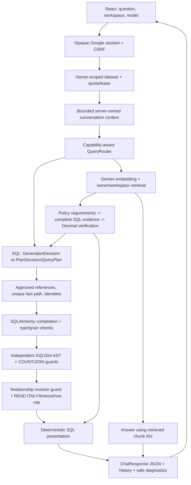

# ShopQuery AI — architecture, reliability and security audit

Audit date: 26/10/2026, Asia/Saigon. This is the current report, updated in place.
Status: IN_PROGRESS; no universal-correctness or release PASS claim.

## Scope, authorization and baseline

Root AGENTS.md read; no nested AGENTS.md found. One main source and one production
deployment on8080. User authorizes bounded offline/live audit and conditional deployment,
200 logical generation stages,100 query embeddings,30 fixture document embeddings for the
entire audit. No previous window reused. Private cumulative ledger is outside Git under
`architecture-audit-20261026/usage-ledger.json`; every dispatch is reserved before sending.
Concurrency, SDK one-attempt policy, provider isolation, Gemini default, fallbackOFF,
gateON/GuestOFF, embedding2/768 and vector-only retrieval remain unchanged.

Initial main9269dc91; application08d71b9020; API2be8945280db / Web03f83efc5f4b.
Strict87modules PASS, no source/config drift. Main PostgreSQL511c4f5a and protected
volume `shopquery-ai_postgres_auth_20261019` healthy, never recreated.40table logical
fingerprints/schema fingerprint, history/session rows, images, source, sanitized Compose
fingerprint and rollback refs captured privately before architecture changes. No secrets,
raw plans/provider JSON or personal rows are committed. Untracked maintenance work is
excluded. Existing sessions/history reload confirmed through Computer Use.

## A. Docker synchronization and cleanup

Actual container references, RepoDigests, tags and OCI revisions checked rather than tag
names alone. No runtime rebuild was needed for baseline synchronization. Only12 obsolete
ShopQuery image manifests were removed, by individually reviewed tags without force:

| Image prefix | Kind | Former source prefix |
| --- | --- | --- |
|1a57c0d15194|API|5ba7669|
|26877f4176df|API|5d4c595|
|5bc66e195142|API|f90592d|
|5db99157ab74|API|a49d4eb|
|5f4ab329c750|Web|881bfe1|
|626a8704c2ba|API|b48cfc2|
|da01d59e8e4d|Web|0656765|
|de4bf4c27fab|API|3364da4|
|df8dff610cd9|API|df10688|
|f161d7f5a441|API, two tags|ac36973|
|fbfeb03fd137|API|e49f838|
|fec296b45cff|Web|df10688|

Kept active API2be89452/Web03f83efc and immediate compatible rollback
API6994abd7/source0656765, Web127da3e8/sourcefd1f510. Historical rollback references
in older report sections are archival; these two are the current rollback pair. All
foreign image IDs and images referenced by running/stopped containers were preserved.
No container, volume, global cache or other project was cleaned. No physical-space
recovery claim: shared layers/cache prevent independent attribution. After cleanup
8080health, runtime identity and strict verifier passed, no API/Web/DB recreate.

## B. Architecture and contracts

| Boundary/modules | Input → output; authority and invariant | Failure / regression |
| --- | --- | --- |
|frontend App/auth/api|UI selection → CSRF-authenticated request; UI never authorizes SQL|auth mock E2E, App tests|
|auth dependencies/oidc/repository|opaque session → invited Principal; state/nonce/PKCE/signature/expiry verified by Authlib; no caller owner ID|401/403; auth and auth integration|
|api routes/resource limits|Principal+dataset → owner repository/context; provider gate and lease before paid work|quota/CSRF/owner guards; management/auth tests|
|datasets parser/repository|bounded file → typed ParsedTable → atomic DDL+rows+registry; source headers retained, formula text never executed|UploadValidationError; parser/import integration|
|relationships detection/repository|registry+full data proof → approved revision N:1; names and values alone insufficient; execution rechecks revision|ambiguous/orphan/NULL/duplicate refusal; relationship tests|
|conversations/context|same owner/conversation/dataset successful snapshot → bounded untrusted reference context; Hybrid only verified classification|unverified/error/owner mismatch clears premise; verified conversation tests|
|routing/router/service|available sources+question → SQL/RAG/HYBRID/UNSUPPORTED; route is a proposal, not authorization|route unavailability never grants missing capability; routing tests|
|ai adapters|schema+prompt → bounded Pydantic wire/domain types; configured endpoint/model only|transport/schema/wire/conversion distinct; SDK mock transports|
|query_plan/generation_contract|one outcome+flat DAG → one internal typed QueryPlan;80nodes/depth8/expanded512; sentinel0/empty only in wire|typed conversion/outcome/predicate errors; contract tests|
|plan_binding|issued references → unique approved fact path and entity identities; no fuzzy remap|unknown source/ref/rel/ambiguous grain; binding tests|
|compiler/expressions|authorized plan → parameterized SQL+provenance+presentation metadata; no model SQL; exact numeric/temporal types|safe compiler branch codes; compiler/property tests|
|validator/count_contract/join_policy|SQL AST → ValidatedSql; independent SELECT/function/schema/COUNT/fact/N:1/grouping guards|unsupported/safety refusal; negative/golden tests|
|executor/relationship guard|ValidatedSql+bound params → ≤200 JSON-safe rows; READ ONLY, local timeout/timezone, rollback|SqlExecutionError; timeout/permission/Decimal integration|
|rag parser/chunker/repository|bounded docs → scoped chunks/vectors; duplicate detection; no OCR/code execution; atomic persistence after embeddings|parser/storage/owner integration|
|rag pipeline|query → embedding/retrieved chunks → answer with only supplied chunk IDs|invalid/missing citation refused; general prose semantics not deterministic proof|
|hybrid policy/binding/coverage/evidence|whole verified source+closed rule+complete SQL → Decimal verdict; freshness/source/identity/unit/count verified|ambiguous/multiple/incomplete evidence refusal; Hybrid negative integration|
|answer/API/history|structured rows+compiled metadata → lossless summary/inline/detail + JSON metadata|no extra AI; no units inferred from alias; presentation/history tests|
|diagnostics/release|bounded request facts → correlations/stages/branches/usage; immutable images → one8080 deployment|no raw content in diagnostics; strict verifier/rollback|

Repositories with setup privileges handle authenticated ingestion/persistence; the model
never receives those privileges. The SQL reader can read uploaded tables across owners
at the database-role level, so application authorization/catalog isolation is a real
security boundary, not claimed PostgreSQL row-level security. Guest uses a separate
NOLOGIN role and temporary tables. Default demo corpus is distinct from user workspaces.

### Capability matrix from implementation

| Capability | Status | Conditions / explicit exclusions |
| --- | --- | --- |
|single-table SELECT/COUNT/SUM/AVG/MIN/MAX|SUPPORTED|authorized registry/types/AST; SUM/AVG numeric; COUNT provenance|
|Decimal/NULL/zero/large integers|SUPPORTED|exact strings for NUMERIC/unsafe integers; no float money or NULL→zero|
|typed comparisons/AND/OR/date ranges|SUPPORTED|type/arity checked; timezone-aware boundaries; no free SQL predicates|
|entity GROUP BY|CONDITIONALLY_SUPPORTED|projected nonaggregates grouped; approved dimension IDs retained|
|category GROUP BY|CONDITIONALLY_SUPPORTED|direct non-identity columns; exact projection/group partition; no injected entity IDs|
|sort/LIMIT/top-N/HAVING|CONDITIONALLY_SUPPORTED|within grain; SUM HAVING subset; cap200 remains; no KPI scope trimming|
|two/three-table JOIN|CONDITIONALLY_SUPPORTED|one/two approved revision N:1 edges, root fact; chain/star only|
|JOIN measures/counts|CONDITIONALLY_SUPPORTED|direct root SUM/AVG and counts; no dimension measures/fanout|
|multiple paths/two fact/composite/self/outer/four uploaded tables|UNSUPPORTED|safe refusal; no arbitrary path choice|
|CTE/subquery/window/writes/catalog/unknown functions|UNSUPPORTED|independent AST guards and reader permissions|
|MD/TXT/DOCX/text-layer PDF|SUPPORTED|upload/expanded archive/page/text limits; no OCR/legacyDOC/macros/URL ingestion|
|vector retrieval/768dims/citations|CONDITIONALLY_SUPPORTED|configured Gemini embedding, scoped owner/dataset; IDs must be retrieved|
|RAG missing/conflicting prose|CONDITIONALLY_SUPPORTED|answer may describe insufficiency/conflict; citation-ID checks do not prove all prose claims|
|RAG follow-up|CONDITIONALLY_SUPPORTED|bounded same-workspace successful reference context, fresh retrieval; no inferred missing facts|
|simple Hybrid KPI/threshold|CONDITIONALLY_SUPPORTED|one whole-source verified numeric rule, source/metric/aggregate/unit/identity bound; Decimal evaluation|
|Hybrid full coverage/freshness|SUPPORTED|two independent coverage checks plus execution result completeness/revision; no WHERE/HAVING/LIMIT exclusion|
|verified conversational classification|CONDITIONALLY_SUPPORTED|server persistence of verified_classification, same owner/conversation/dataset; fresh evidence|
|multiple rules/exceptions/ambiguous policies|UNSUPPORTED|closed grammar, fail closed; no model-generated authoritative verdict|
|BGE reranking in current runtime|UNSUPPORTED|vector-only retained; no benchmark/quality claim|

## C. Findings and root causes

| Severity | Confirmed evidence | Correction / disposition |
| --- | --- | --- |
|HIGH|pypdf6.20.1 has seven published parsing/resource advisories, certifi2026.7.22 revoked-CA advisory|lockfile pypdf6.21.2/certifi2026.10.23; existing allowed ranges; source advisories below; parser/TLS regressions required|
|MEDIUM|npm audit: undici8.11.2 has high DoS advisory via dev jsdom; not shipped in static Web|compatible transitive8.12.3 lock update; no npm force; audit now0|
|MEDIUM|captured NEW Knowledge plan selects station name but groups only station ID; compiler line283 rejects projection grain|keep refusal; code projection_grain, explain all projected nonaggregate attributes in Planner contract; no automatic grouping coercion|
|MEDIUM|same captured NEW plan has malformed where/having strings; wire/domain accepted shape and Binder ignored these fields|predicate_reference validators and bounded field lengths; Binder includes both references; no JSON repair|
|MEDIUM|compiler generic KeyError/ValueError/TypeError and direct raises lost exact failing invariant|safe allowlisted codes for projection/expression/types/clauses/literals/provenance; no raw exception logging|
|MEDIUM|CSV list(reader) materializes every row before row-cap check; failing bounded-reader test proves overconsumption|stream parsed records, stop at max_rows+1; preserve malformed-CSV translation and original limits|
|MEDIUM|full baseline suite16failures: tests still expected nested provider PlanDecision, wire-only semantic acceptance, AI SQL grounding|updated assertions to current production classes/contracts and deterministic presentation; keep negative cases; no production behavior rollback|
|LOW|provider usage facts absent in request diagnostics; repeated paid diagnostics needed historically|bounded logical generation/query/document counters and safe numeric SDK token metadata in existing trace; absent tokens stay unknown|
|LOW|embedding response checked dimensions but not finite values|reject NaN/Inf before vector repository; negative regression|

Original JOIN correlation `f93ddf2487a14353a848acfbba5bd457`:
**ORIGINAL_PLAN_UNAVAILABLE**. Confirmed original stage remains plan_compilation before
execution, exact original invariant UNKNOWN. One separately authorized audit diagnostic
(one Knowledge stage, no SQL execution) captured a new equivalent failure at actual
`QueryCompiler._compile` projection-grain raise. Its malformed predicates are a second
independent issue in that new response. Never claim this reconstructs the old JSON.

The reconstructed valid counterpart groups both approved ID and selected name and
compiles through unchanged JOIN/count/AST guards. Invalid counterpart stays refused with
stable code; malformed predicate cannot be treated as absence. Four focused tests failed
before these corrections. All supported-domain semantic authorizations remain in backend.

No new compiler/provider schema family/service/framework was introduced. Prompt change
is two sentences explaining a proven missing GROUP BY obligation, not a new NLU grammar.
Legacy SQL-only dataset context forbids categories but is not transmitted by current
uploaded Planner/Router; retained, marked as documentation debt, not blamed for live errors.

## D. Test strategy and golden regression

Full offline suite is used in this audit, rather than previous repair-only CI selection.
Baseline:1268PASS/16FAIL/841deselected. After stale-test corrections and first diagnostic
regressions:1288PASS/841deselected. Final counts will be recorded after final CI.
Frontend initial85unit/lint/typecheck/build PASS. No claims of provider live success from mocks.

Existing tests are consolidated with `reliability_golden` marker in conftest; no duplicated
business-rule framework. Run `pytest -m "reliability_golden and not integration and not live"`.
Database side uses the same marker with `integration`, CI-isolated PostgreSQL only.

| Failure class | Minimal production-path regression | Expected outcome/stage |
| --- | --- | --- |
|Knowledge503|test_providers/error_contract|provider transient/request, no SQL, eligible fallback only by policy|
|wire/outcome/conversion|generation_contract/contract_conversion|invalid shape wire_validation; typed domain branch; one call|
|unknown source/ref/relationship|plan_binding/plan_security|binding refused, no nearest-column remap|
|missing projection grouping / Knowledge JOIN|compiler_diagnostics|projection_grain at compilation; valid grouped counterpart accepted|
|category false entity expansion / row cap|category_grouping/category_results_integration|12partition groups/oracle; no IDs injected; cap unchanged|
|numeric>100|category_results_integration/reliability_properties_integration|strict boundary, no JOIN; independent numeric oracle|
|COUNT/null/fact grain|count_conformance|row_count distinct from non-NULL count; dimension/fanout refused|
|incomplete KPI WHERE/HAVING/LIMIT|evidence_coverage/hybrid_evidence_integration|coverage refusal before execution; full counterpart verified|
|unverified/cross-owner follow-up|verified_conversation_contract/conversation_context|untrusted premise not reused; current evidence required|
|citation/owner mismatch|document_upload_integration/hybrid_evidence_integration|no cross-workspace evidence; citation IDs tied to retrieved set|
|Decimal/NULL/presentation/history|decimal_contract/result_presentation|exact JSON/formatting, no added generation, metadata persists|

Added49 seeded unit property cases: catalog permutation/ref-ID stability, aliases do not
change provenance, malformed predicates never repaired, unknown authority remains refused.
Added8 isolated PostgreSQL metamorphic fixtures: source-row permutations, category partition,
exact Decimal sums, NULL/value-count difference, > vs>=100, bounded READ ONLY oracle.
Existing chain/star/context permutation tests cover N:1 no-fanout, multilingual domains,
time boundaries, owner/workspace mutation and policy/citation negatives. No Hypothesis
dependency needed for these bounded replayable invariants; not an exhaustive fuzzing claim.

## E. Provider scorecards and paid ledger

Audit budget used so far: one Knowledge diagnostic stage,0 query/document embeddings.
Old windows excluded. Final scorecard will separate provider invalid plan, backend defect,
unsupported refusal, missing evidence and transport failures; no aggregate misleading PASS.
Small batches only, sequential, existing quotas applied, no paid repair loop/fallback.
Counts are logical SDK stages; runtime attempts1. Token metadata is measured when supplied,
not estimated as zero when missing. No monetary-cost claim without verified pricing/usage.

## F–H. Integrity, limitations and release recommendation

Main DB DDL/DML is not used for oracle tests. Existing approved synthetic dataset15/16
may be read with owner-scoped context; controlled chat history/resource-limit writes are
expected during live acceptance. No corpus re-embedding, relationship edits, session reset,
auth weakening, BGE load or other project changes. CI DB is isolated and disposable.

General RAG prose is grounded by retrieval/citation constraints but not a deterministic
theorem prover. Hybrid grammar intentionally narrow. Model semantic correctness is not
guaranteed by schema validation: unsupported or malformed proposals must be rejected.
Zero-fact entity classification remains conditional on complete evidence guards; INNER
JOIN does not synthesize missing entities. No general enterprise availability/load claim.
Small samples do not support universal accuracy or reliable population p95 estimates.

Current recommendation: LIVE_ACCEPTANCE_PENDING for audit changes. Current8080 baseline
continues serving Gemini. Knowledge default/fallback promotion requires all functional and
security gates; not enabled based on diagnostic or a single COUNT/SUM success.

## Technical sources and version alignment

- [PostgreSQL17 SELECT](https://www.postgresql.org/docs/17/sql-select.html) and
  [aggregates](https://www.postgresql.org/docs/17/functions-aggregate.html): actual runtime
  major17, not current18; SQL capabilities remain a deliberately smaller guarded subset.
- [SQLAlchemy2.0 Select](https://docs.sqlalchemy.org/en/20/core/selectable.html),
  [SQLGlot source](https://github.com/tobymao/sqlglot): installed lockfile behavior tested,
  no assumption that parse success proves semantic safety.
- [Pydantic errors](https://docs.pydantic.dev/latest/errors/errors/) and
  [validators](https://docs.pydantic.dev/latest/concepts/validators/): errors emitted with
  input/ctx/url excluded and allowlisted loc/type; semantic validators complement JSON shape.
- [Gemini structured output](https://ai.google.dev/gemini-api/docs/structured-output):
  shared flat contract, SDK serializer tests, backend remains semantic authority.
- [OWASP GenAI risks](https://github.com/GenAI-Security-Project/GenAI-LLM-Top10): prompt
  injection, improper output handling, sensitive disclosure, excessive agency/resource use
  mapped to scope/AST/quotas/gates; model prompting alone is not an authorization boundary.
- [pypdf6.21.2 patches](https://github.com/py-pdf/pypdf/releases/tag/6.21.2),
  [content stream resource advisory](https://github.com/py-pdf/pypdf/security/advisories/GHSA-cgf9-327m-v77c),
  [certifi revoked roots](https://github.com/certifi/python-certifi/security/advisories/GHSA-6q48-6c7w-9gw2),
  [undici advisory](https://github.com/nodejs/undici/security/advisories/GHSA-xjj6-f33q-929c).
- [Docker image removal](https://docs.docker.com/reference/cli/docker/image/rm/): reviewed
  tag removal distinguished from final manifest deletion; no force or global prune.
- [Hypothesis stateful guidance](https://hypothesis.readthedocs.io/en/latest/stateful.html):
  standard generated tests suffice for current bounded invariants; no new framework needed.
