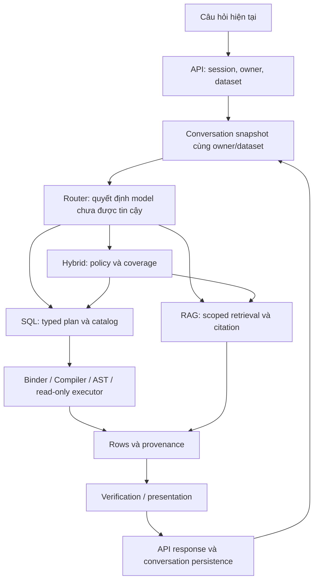

# Tái thiết kế lõi: hồ sơ kiểm toán và quyết định

## Trạng thái và nguồn bằng chứng

Theo chỉ thị operator tiếp theo, kết thúc audit mở rộng và bắt đầu xây lõi theo kiến trúc B. Các khoảng trống lịch sử bên dưới không được đánh dấu PASS; chỉ đóng theo module đang triển khai. Source đang ở
`codex/routing-context-contract`, HEAD `f04922a`; main/origin/main baseline `b09ec4e`.
Những thay đổi RAG/API/context/tests từ nhiệm vụ trước còn chưa commit được bảo toàn.
Chúng là candidate offline, không phải source đang phục vụ 8080.

[Danh mục source](source_inventory.json) ghi hash working tree, interface/import Python
và tham chiếu test tìm được tĩnh. Có 359 file ở thời điểm tạo, 112 file production,
88 module Python production kể cả package markers. `UNKNOWN` có nghĩa chưa hoàn tất
review chức năng; AST/import hoặc tìm được test không chứng minh code đúng hoặc test đủ.
Không suy file không dùng chỉ từ việc không tìm thấy import tĩnh.

Runtime baseline API application `4ab2c5a`, image
`sha256:2d27fba187bb8703ebefbb214931933576767a52d7a32855b05d4a25c3bf5d98`;
Web application `de0572e`, image
`sha256:b2188879d84d6069f66dd73a13210bb810d269a23366aa77d6d4fd6eb307a7b3`.
Baseline CI `3e50467` PASS không áp dụng cho working tree chưa commit.

## Luồng và thẩm quyền cần rà soát

| Boundary | Bên tạo | Thẩm quyền thực tế | Khoảng trống đã có bằng chứng |
| --- | --- | --- | --- |
| Current request/context | User và server-owned history | Session/owner/dataset, bounded context | Legacy RAG từng được coi successful vì error=null; candidate chỉ giữ prior question không thẩm quyền |
| Route/task | Model adapter | Typed validation/capability dispatch | JSON đúng có thể sai task, selection hoặc population |
| Plan/binding | Model hoặc deterministic coverage builder | Issued catalog IDs, approved N:1, types/grain | Plan đúng không chứng minh toàn bộ điều kiện của ngôn ngữ tự nhiên đã được giữ |
| Coverage | Policy parser và model classification | Policy binding và hai coverage validators | classification có thể bỏ qua kiểm toàn câu trong resolve_coverage; năm regression offline xác nhận |
| Execution | Compiler/executor | AST, bound params, owner, transaction/read-only/timeout/cap | Không thể xác minh ý nghĩa phần câu hỏi đã bị mất trước bước này |
| RAG | Retriever/model | Source ownership, chunk membership | Citation tồn tại không chứng minh entailment hoặc completeness |
| Result/persistence | Composer và API | Metadata nguồn server | Cần tách trạng thái transport, evidence và premise; không backfill legacy phỏng đoán |

Các phát hiện trên có mức bằng chứng khác nhau: regression offline chứng minh đường
code, không chứng minh mọi request production đã sai. Hồ sơ tái hiện và giới hạn ở
[correctness review](correctness_review.md). Chưa hoàn tất review transaction/race,
resource cleanup, tất cả frontend/maintenance modules và tất cả đường lỗi.

## So sánh kiến trúc ban đầu — chưa phải quyết định xây dựng

| Hướng | Lợi ích có thể có | Rủi ro cần chứng minh | Điều kiện lựa chọn |
| --- | --- | --- | --- |
| A: chỉnh cấu trúc hiện tại | Ít migration và thay runtime | Có thể tiếp tục tin semantic fields rời rạc; guard đóng gây false refusal | Chỉ chọn nếu contract thống nhất sửa đủ lỗi mà không tái tạo regression |
| B: thay lõi domain trong modular monolith | Một request/evidence/result contract xuyên suốt; tận dụng compiler/owner/auth | Typed specification vẫn do model sinh; không tự có semantic proof | Phải khóa requirements, proof obligations, capability matrix và independent benchmark trước code |
| C: thay framework/orchestration | Có thể hữu ích nếu thiếu orchestration thực sự | Thêm dependencies/calls/migration mà không chứng minh semantics | Hiện chưa có bằng chứng cần thay stack |

Không kiến trúc nào chứng minh tự động hiểu mọi câu ngôn ngữ tự nhiên. Thiết kế phải
nêu rõ trust assumptions và điều kiện cần clarification; không gọi model self-report
là kiểm chứng độc lập. Population predicates, policy predicates, output selection và
ordering/limit cần hợp đồng riêng về ý nghĩa, cùng nguồn sự thật được dùng từ planning
tới execution, result và persistence. Chưa chốt wire schema hoặc thêm model verifier.

## Nghiên cứu và giới hạn áp dụng

| Nguồn | Nguyên tắc phù hợp | Điều không được suy ra |
| --- | --- | --- |
| [RAT-SQL](https://aclanthology.org/2020.acl-main.677/) | Schema/relationship grounding | Không chứng minh user qualifiers đã được giữ |
| [Spider](https://aclanthology.org/D18-1425/) và [BIRD](https://proceedings.neurips.cc/paper_files/paper/2023/hash/83fc8fab1710363050bbd1d4b8cc0021-Abstract-Datasets_and_Benchmarks.html) | Cross-schema evaluation và dữ liệu thực thi | Không thay independent oracle bằng route accuracy |
| [Spider 2.0](https://proceedings.iclr.cc/paper_files/paper/2025/hash/46c10f6c8ea5aa6f267bcdabcb123f97-Abstract-Conference.html) | Enterprise workflow khác benchmark SQL đơn giản | Kết quả mô hình trong bài không phải benchmark của ShopQuery |
| [PICARD](https://aclanthology.org/2021.emnlp-main.779/) | Ràng buộc formal language và parsing | Syntactic validity không tự là semantic completeness |
| [ALCE](https://aclanthology.org/2023.emnlp-main.398/) | Tách correctness và citation quality | Citation ID đúng không chứng minh claim được hỗ trợ |
| [ToTTo](https://aclanthology.org/2020.emnlp-main.89/) | Presentation cần trung thành dữ liệu | Không dùng data-to-text score để chứng minh query đúng |

Đây là tổng hợp phạm vi nghiên cứu, không tuyên bố đọc toàn bộ mã dependency hoặc đạt
benchmark học thuật. Còn phải đối chiếu APIs/source đúng phiên bản đang pin trước khi
chốt công nghệ, đặc biệt schema serialization, transaction/SQL AST và provider errors.

## Gates và công việc tiếp theo

### Audit tiếp nối: bằng chứng và nghĩa vụ còn mở

Các record có `source_boundary_reviewed_tests_partial` là review source theo nhánh,
không phải nghiệm thu toàn bộ tests hoặc runtime. Package markers được đọc nguyên file,
đếm riêng vì không có logic thực thi. Các tên test có chú thích pending không được tính
là bằng chứng đã review assertion hoặc đã chạy. Đã đọc source100 file có logic và12 package markers; review assertions/fault paths còn thiếu như inventory ghi rõ. Phase A–C chưa ACCEPTED.

Trong lượt tiếp nối, `test_auth.py` và `test_sql_executor.py` được đọc các assertion quan
trọng và chạy offline: **54 PASS**. Chúng kiểm signed OIDC claims sai issuer/audience/
expiry/nonce/signature/invite, CSRF/auth trước DB/provider, transaction read-only,
timezone/timeout và rollback ở lỗi query/timezone/row cap. Không chứng minh fresh Google
login, server provider hoặc PostgreSQL integration trong lượt audit này.

Phép tái hiện frontend bằng TypeScript transpile trong RAM gọi trực tiếp
`api.ts::parseChatResponse`: response có `result_columns='invalid'` và
`verification_status='invented'` vẫn được chấp nhận. Đây là **CONFIRMED_OFFLINE** về
runtime contract validation, chưa có bằng chứng server production trả payload tương tự.
Không sửa production trong nhiệm vụ audit.

| Boundary | Proof obligation | Negative/counterexample | Bằng chứng và phần còn thiếu |
| --- | --- | --- | --- |
| Session → work | Mọi write/AI/DB private có principal/CSRF đúng trước side effect | Owner khác, token cũ/hết hạn, Origin khác | Auth unit54 subset PASS; DB session/lease race integration còn phải đọc/chạy phù hợp |
| Conversation → context | Current question ưu tiên, context cùng owner/dataset, failed turn không làm premise | RAG refusal có citation; history giả; đổi session; timeout sau ghi user | Candidate context/tests có từ lượt trước; chưa xác nhận toàn bộ failure persistence |
| Persistence | Cặp turn hoặc trạng thái interrupted phải được nhận diện rõ, không nối nhầm lượt | Crash/DB error giữa add_user_message và add_response_message; conversation delete khi inference chạy | Source dùng hai transaction riêng; đây là nghĩa vụ cần fault injection, chưa gán CONFIRMED defect |
| Semantic request → plan | Mọi điều kiện ảnh hưởng kết quả được giữ/đánh dấu chưa hiểu | Input tháng/khu vực khác output qualified/top-N | Năm regression coverage đã FAIL; AST/catalog không chứng minh semantics bị mất trước plan |
| Plan → binding | Chỉ hoàn thiện cấu trúc duy nhất từ approved metadata | Multiple fact measures/path mơ hồ/category grain | Đã đọc binder; detailed property/integration assertions chưa hoàn tất |
| Compiler → executor | Bound SQL và evidence SQL cùng provenance, không normalization làm đổi execution | Bỏ WHERE/HAVING, đổi COUNT, sai time offset, fanout | Đã đọc compiler/expressions/validator/executor; full JOIN/COUNT audit còn mở |
| Retrieval → RAG | Owner scope + citation membership độc lập answerability/entailment | Citation đúng nhưng thiếu ý/answer trắng; document instruction | Đã đọc parser/chunker/pipeline/repository/reranker; semantic completeness vẫn chưa có authority proof |
| API → frontend | Public metadata kiểm đúng schema trước render, không suy verified từ HTTP200 | Invalid metadata array/verification enum; legacy thiếu fields | Direct parser repro xác nhận gap; new result/state contract và UI compatibility cần thiết kế |
| Frontend session → state | Late response của A không hiển thị ở B; logout phải có server acknowledgement | Aborted fetch ignores cancellation; focus revalidation fails | Đã đọc AuthBoundary tests về epoch/queued writes/logout; App create/send races còn cần review |

### Capability contract dự thảo — chưa khóa thiết kế

| Capability | Evidence/thẩm quyền | Điều kiện và giới hạn phải giữ | Trạng thái thiết kế |
| --- | --- | --- | --- |
| SQL records/COUNT/SUM/AVG | Authorized catalog; typed plan; reader result | NULL/Decimal; COUNT row/value; no inferred units | Giữ compiler/executor dưới contract mới; JOIN/COUNT audit chưa xong |
| JOIN2/3 và grouping/ranking | Approved N:1 revision/key/full-data checks | Fact measures; no fanout/category grain; stable order cần proof | Không có căn cứ viết lại engine; review chi tiết còn mở |
| Dates/identifiers | Registry type; business timezone; exact values | Giữ offset, không numeric-format DATE/ID | Executor/source reviewed; metamorphic oracle còn cần đối chiếu |
| RAG explanation | Scoped source retrieval/citation | Không đồng nhất relevance, ID membership và entailment | Candidate metadata có giá trị; chưa là factual verifier |
| Hybrid classification | Bound complete policy + metric/identity/population proof | Selection sau evaluation; limit/order sau verified classification | Blocker semantic/predicate coverage chưa giải quyết |
| Filtered policy/rule exceptions | Verifier đúng grammar + source predicates | Không xóa qualifiers để ép all | Unsupported khi chưa đủ proof; chưa mở grammar |
| Follow-up | Server-owned bounded context with route-specific trust | Same owner/dataset; retrieve fresh evidence; legacy conservative | Cần contract phân biệt reference và authoritative result |
| Ambiguous/unsupported/provider failure | Explicit outcome and safe error category | Clarification khác false refusal; timeout khác missing evidence | Chưa khóa unified outcome states |

Hướng B hiện là lựa chọn thiết kế ưu tiên có điều kiện, chưa khóa acceptance hoặc thay wire schema. Cần giải quyết authority của
semantic specification: model-only claim và exact source-span match vẫn không chứng
minh đã diễn giải đủ yêu cầu. User confirmation có thể là một nguồn thẩm quyền cho
phần chưa chứng minh, nhưng tác động UX/acceptance chưa đánh giá và không được dùng để
đổi gold hoặc gọi các câu hợp lệ bị từ chối là PASS.

1. Hoàn tất từng hàng production trong inventory: inputs/outputs/side effects/ownership,
   validation/error/security, runtime usage, test coverage và disposition có căn cứ.
2. Hoàn tất review critical path và map mọi mutation nguy hiểm sang assertion độc lập.
3. Khóa capability/requirements, chọn A/B/C và thiết kế contracts với proof obligations.
4. Kiểm chứng thiết kế bằng counterexamples; chỉ sau đó viết lõi thay thế.
5. Kiểm thử đa schema, PostgreSQL oracle, semantic/live và release gates như yêu cầu.

Ngân sách nhiệm vụ mới: tối đa120 generation/24 query/0 document re-embedding;
chưa dispatch lời gọi trả phí. Không cộng/reset các cửa sổ cũ vào ngân sách mới.
Runtime, databases, models, sessions/history và rollback giữ nguyên trong Phase A–C.

## Tiếp nối kiểm toán ngày28/10: phạm vi đã đọc và kết quả mới

Inventory hiện có **100 file có logic đã review source boundary,18.559 dòng** và
**12 package markers đã đọc**. Tổng112 production files đều có disposition sơ bộ;
`source_boundary_reviewed_tests_partial` cố ý KHÔNG có nghĩa functional audit complete.
**8.327 dòng critical-path** là tổng chiều dài các file `api/`, `auth/`,
`conversations/`, `rag/`, `routing/`, `text_to_sql/` đã đọc; không phải số nhánh được
thực thi, coverage đo tự động hoặc chứng nhận112 file. Import/dependency/test references
cũ giữ nguyên; mục `behavioral_tests` phân biệt assertion đã đọc với pending và execution.

Sáu file targeted chạy mới: `test_plan_binding.py`, `test_query_compiler.py`,
`test_relationship_detection.py`, `test_relationships.py`, `test_hybrid_policy_binding.py`,
`test_verified_conversation_contract.py`: **103 PASS,5,79s**, offline/mocks; không DB/provider.
Cộng với54 auth/executor của lượt audit trước là157 tests trong hai lệnh khác nhau;
không cộng162 PASS lịch sử thành một suite hiện tại. Không chạy lại toàn regression/golden.
Năm FAIL semantic coverage được giữ nguyên;103 PASS không xóa các failure đó.

### Defect ledger — phân biệt lỗi chứng minh với nghĩa vụ chưa kiểm

| ID | Tầng/function và bằng chứng | Nguyên nhân/kết quả | Mức bằng chứng, xử lý trong nghiên cứu |
| --- | --- | --- | --- |
| D1 | `routing/hybrid_coverage.py:73-96::resolve_coverage`; `test_evidence_coverage.py`5 negative cases | `classification` supplied chọn thẳng selection, bỏ `classification_selection(question,...)`; full-entity coverage hợp lệ của policy bị dùng thay coverage câu hỏi, mất tháng/khu vực/top-N hoặc đảo qualified/not_qualified | CONFIRMED_OFFLINE; cần thay semantic authority contract, không gắn thêm regex đóng gây false refusal |
| D2 | `rag/pipeline.py:113-162::answer_from_chunks`; candidate `conversations/context.py` | Citation membership chứng minh ID thuộc retrieved set, không chứng minh answer trả đủ/đúng. Legacy error=null từng cấp trust cho RAG; candidate chỉ dùng prior user question reference-only | Source/negative regressions; candidate chưa deploy; không tuyên bố factual verifier đã có |
| D3 | `frontend/src/api.ts::parseChatResponse`, direct in-memory TypeScript repro | `result_columns='invalid'`, `verification_status='invented'` được cast/chấp nhận; compile-time DTO không là runtime parser | CONFIRMED_OFFLINE malformed contract; chưa thấy server production trả payload này |
| D4 | `rag/upload_parser.py::parse_document_file`, `rag/chunking.py::chunk_document`, `database/models.py:176-177` | Tên file213 ký tự được parser nhận nhưng chunk.source_file tối đa200; heading301 được chunker giữ nhưng section_title tối đa300. Repository embeddings chạy trước insert; lỗi width có thể phát hiện quá muộn | CONFIRMED_OFFLINE parser/ORM mismatch, chưa ghi thử DB hoặc tốn embeddings; phải validate trước paid side effect, không tự cắt mất citation identity |
| D5 | `routing/natural_policy.py:303::_parse_regulation` | Grammar sectioned yêu cầu đúng phrasing “Ban hành cho bộ dữ liệu tổng hợp”/“Hiệu lực kiểm thử”, nên hỗ trợ nhiều entity tên khác vẫn không chứng minh hiểu chính sách tự nhiên tổng quát | Source-confirmed capability limitation; không dùng holdout chỉ đổi tên để tuyên bố generalization |
| D6 | `guest/routes.py:224::chat` vs `_chat_response` | Guest response dựng riêng, không chuyển `verification_status`/candidate RAG trust fields từ result; API contract có thể mất metadata qua nhánh này | Source-confirmed omission; Guest AI runtime OFF, không quy thành production incident hoặc bật để thử |
| O1 | `api/routes.py:230::_persist_chat_turn`, repository160/190 | User/assistant commits riêng; ShopQueryError được persist nhưng unexpected exception/DB fail/delete races cần trace-state obligation | OPEN TEST OBLIGATION, chưa chứng minh cross-turn corruption; không sửa schema trước fault evidence |
| O2 | `frontend/src/App.tsx::submitQuestion` | Await createConversation trước khi đăng ký requestController; đổi workspace/new-chat trong thời gian await cần kiểm sequence; UI disabled thực tế phải đối chiếu | OPEN TEST OBLIGATION; không gán race đã xảy ra khi chưa tái hiện |
| O3 | Workspace context/relationship execution guard | Upload immutable + dataset shared lock bảo vệ JOIN revision, nhưng profile/catalog snapshots và single-table deletion race cần đối chiếu transaction thực tế | OPEN TEST OBLIGATION; reader role/AST vẫn bảo vệ truy cập được biểu diễn |

### Call graph thực tế và authority qua từng bước

Các đường sau là source hiện tại trong working tree, không phải một pipeline mới:

1. **Authentication/persistence:** `auth.dependencies.require_session` → signed session
   lookup/Origin+CSRF cho write → `api.routes.send_conversation_message` owner/dataset get,
   provider gate/resource lease → `_persist_chat_turn` → `add_user_message` commit →
   `contextual_question` trên snapshot server-owned → service → `_chat_response` hoặc
   `_chat_error` → `add_response_message` commit JSON metadata → `_message_response` và reload.
   User request schema không cho tự khai verification status. History metadata có thể là
   legacy, phải giữ unverified khi không có bằng chứng mới; không bulk rewrite lịch sử.
2. **SQL:** `DatasetChatService.chat` → `QueryRouter.route` →
   `TextToSqlPipeline.run` → `QueryPlanner.generate` → provider flat generation/conversion
   → `bind_approved_grain` → `QueryCompiler.compile` → SQL AST validations →
   `RelationshipRepository.execution_guard` khi JOIN → `SqlExecutor.execute` reader
   transaction/timezone/timeout/row cap → lossless rows/provenance → `compose_sql_answer`.
   Model có quyền đề xuất task/reference/predicate, không cấp SQL identifiers/owner/edge.
3. **RAG:** service → `RagPipeline.retrieve` → query embedding → scoped repository
   vector retrieval → optional reranker → `answer_from_chunks` structured draft →
   citation ID membership → RagResult. Chunk ownership/hash không tương đương entailment.
4. **Hybrid:** service scope gate → `HybridPipeline.run` → retrieve →
   `complete_policy_evidence` → `numeric_policies` → `resolve_coverage` → deterministic
   coverage plan hoặc existing planner → plan coverage validation → compiler → compiled
   coverage validation → guarded SQL → entity-count check → `verified_policies` /
   `validate_policy_binding` → `verified_classification`/Decimal → `compose_answer` →
   output selection → full evidence rows + `answer_row_indices` + verification metadata.
   Hai coverage validators giữ đúng structural requirement nhưng requirement hiện có thể
   thiếu user predicates vì D1. Không được dùng hai PASS đó thay semantic completeness.
5. **Follow-up:** persisted snapshot → bounded eligibility → current request tách riêng
   qua service/router → retrieve/query lại. Không tái dùng row values/threshold từ assistant
   text làm evidence. Current question giữ ưu tiên nếu history nói đổi scope/route.

### Phương án kiến trúc sau source review — B ưu tiên, chưa được triển khai

| Tiêu chí có bằng chứng | A: giữ orchestration, thêm guard | B: một semantic/evidence contract trong modular monolith | C: framework/agent orchestration mới |
| --- | --- | --- | --- |
| D1 qualifier/selection | Thêm fullmatch đã phá9 câu hợp lệ trong thử nghiệm trước; dễ thêm authority song song | Một specification cho các bước, obligation gắn predicate/lineage; đúng vị trí mất thông tin | Framework không tự hiểu qualifier hoặc chứng minh absence |
| D2 RAG/premise | Metadata rời rạc dễ bị coi đồng nghĩa successful | Evidence/answerability/premise là trạng thái riêng; adapter compatibility | Thêm calls/verifier chưa có oracle correctness |
| SQL/security đã có | Tái sử dụng được | Giữ compiler/executor/auth/owner/joins/Decimal; thay đầu vào semantic và orchestration | Rewrite tăng surface/risk không có lợi ích đo được |
| Vận hành/dữ liệu | Thay ít nhưng rủi ro semantic vẫn phân tán | Một API,DB,Compose; additive compatible metadata; không service/model mới | Tăng migration/dependency không có nhu cầu được chứng minh |
| Kết luận | Không chọn làm kiến trúc mục tiêu; không tiếp tục vá fullmatch | **Hướng duy nhất đề nghị chốt**, phụ thuộc proof/benchmark gates bên dưới | Loại ở phạm vi hiện tại |

Giữ `query_plan`, compiler/expression checker, SQL validator, executor, COUNT analyzer,
JOIN policy, authenticated repositories, relationship full-data verifier, vector repository,
OIDC/session và Langfuse export. Giữ không có nghĩa đóng mọi test gap. Rework Router/service,
planner/wire adapter, conversation trust, RAG result/public DTO; thay resolver coverage
all-entity thành cơ chế derive requirement từ specification. Parser policy chỉ được mở rộng
khi có grammar/authority/negative evidence riêng; không viết lại thành model verdict engine.

### Typed contracts đề xuất và quyền tạo từng trường

Đây là thiết kế dữ liệu, chưa phải Pydantic code hoặc provider wire đã nghiệm thu.
Không dùng các tên dưới đây làm lời hứa formal correctness cho mọi ngôn ngữ tự nhiên.

| Contract | Fields có ý nghĩa bắt buộc | Authority/validation |
| --- | --- | --- |
| RequestEnvelope | owner,conversation,dataset,catalog revision,current text,reference date/timezone | Server tạo từ session/registry; model không ghi/chỉnh; current text immutable |
| TaskProposal | operation=records/aggregate/explain/apply_policy; required evidence; referenced subject/metrics; clause bindings; unresolved clauses | Model đề xuất trong generation hiện có; không sinh verified hoặc successful flags |
| PopulationSpec | root fact, entity identity/grain, row predicates, entity predicates, temporal interval/timezone | References issued từ catalog; values đúng kiểu; predicate conjunction/disjunction giữ cây; không mặc định all vì model không gửi filter |
| PolicyRequirement | scoped document/rule candidate, applicability predicates, metric provenance, unit/operator/threshold, completeness status | Backend whole-source/hash/binding checks cấp quyền; model extraction chỉ candidate |
| OutputSpec | projection, qualified/not_qualified/all selection, result predicate, ordering, limit,tie semantics | Tách khỏi input population/policy applicability; limit không chạy trước verdict để giả full coverage |
| BoundTask | normalized specification + mapping từng requirement tới QueryPlan/policy/action + unresolved obligations | Backend chỉ bind độc nhất từ approved metadata, không tự chọn metric/path hay xóa mệnh đề |
| EvidenceBundle | dataset revision,execution SQL/provenance,typed rows,entity universe/coverage,scoped source identities | Server executor/repository tạo; citation ID/order/row count không tự chứng minh semantic coverage |
| ResultEnvelope | outcome,route,evidence status,answerability status,semantic status,rendered answer,selected indices,citations,usage/error | Backend compose; no client/model verified flag; API/frontend/persistence dùng chung semantics |
| ConversationReference | originating turn,current scope,task reference,evidence revision,trust state | Server tạo; failed/refused/interrupted/legacy không có verified result; references khác evidence |

`outcome`: answered / partially_answered / clarification_required /
unsupported_operation / insufficient_evidence / provider_failure / execution_failure.
`semantic_status`: proposed / bound / ambiguous / unresolved, không gọi `bound` là proof
đã hiểu đủ NLP. `evidence_status` phân biệt source_scoped, citation_validated,
policy_bound, coverage_checked; không ép thành một boolean. `premise_trust`:
ineligible / reference_only / verified_result. SQL executed đúng AST chưa đủ thành
verified_result nếu nghĩa câu hỏi chưa được nghiệm thu. Citation_validated RAG chỉ
reference_only. Hybrid chỉ verified_result khi đủ scope,policy,coverage,metric/verdict.
Legacy nullable giữ nguyên, đọc thành unknown/ineligible; không tự upgrade.

**Trust assumption bắt buộc công khai:** không có deterministic checker tổng quát để
chứng minh model không bỏ sót một ý trong câu tự nhiên. Source-span matching cũng không
chứng minh ý nghĩa hoặc absence của negation. Vì vậy specification giảm mất thông tin
và hỗ trợ mutation testing, không tuyên bố loại bỏ semantic error hoàn toàn. Phần hiểu
ngôn ngữ phải chấm độc lập trên holdout nguyên văn; câu hợp lệ bị clarification/refusal
vẫn FAIL nếu gold yêu cầu trả lời. Không cho model tự gắn all_entities để bỏ qua các
unresolved clauses, không thêm verifier call/retry nhằm tạo bằng chứng giả.

### Counterexamples bắt buộc giữ trong thiết kế

| Câu/biến thể | Population | Policy | Output | Điều sai phải phát hiện |
| --- | --- | --- | --- | --- |
| Những kho ở miền Bắc chưa đạt KPI tháng trước, chỉ lấy2 kho có phí thấp nhất | Entity region + fact half-open month | Chính sách đúng hiệu lực,threshold trên metric trong population đó | not_qualified,order metric asc,limit2 sau evaluate | all-entity SQL; lấy2 trước evaluate; bỏ month/region; đảo verdict |
| Chỉ tính đơn đã giao; kho nào đạt theo quy định tất cả trạng thái? | User status restriction | Applicability xung đột all-status | Chưa thể kết luận cùng một metric khi scope không tương thích | Tự bỏ status hoặc dùng tổng một phần làm KPI toàn bộ |
| Theo tài liệu, KPI có loại đơn hủy không? | Không chạy table query | Giải thích rule/evidence | Document answer | Thấy “KPI/đơn” rồi chạy Hybrid/classification |
| Vậy những kho chưa đạt? sau verified Hybrid | Resolve subject/policy từ cùng turn/scope | Retrieve fresh same-workspace rule | not_qualified trên population tiền đề còn rõ nghĩa | Dùng threshold/rows từ assistant, hoặc quên population trước |
| Tên kho giống nhau, ID khác nhau | Entity key riêng | Threshold từng entity | Hai entity, không gộp theo tên | Binder tự đổi entity/category grain |
| NULL,0.00,ngưỡng bằng40.00 | Preserve source values,COUNT kind | NULL thiếu bằng chứng;zero so sánh thật;exact equality | Phân loại đủ trạng thái | COALESCE0 hoặc float rounding/COUNT(column)=COUNT rows |
| Citation đúng nhưng trả thiếu thời hạn/bằng chứng cần lưu | N/A | Hai requirements được hỏi | partial hoặc đủ hai claims có support | ID membership=answerability PASS |

### Proof obligations và negative-test closure còn phải hoàn tất

| ID | Ranh giới | Chứng minh phải có trước acceptance | Hiện trạng |
| --- | --- | --- | --- |
| P1 | Envelope/auth → catalog | Cross-owner/dataset/client IDs không truy cập/gọi provider; CSRF trước writes; stale session invalid | Auth54 subset PASS; integration ownership/lease assertions cần đối chiếu đầy đủ |
| P2 | Text/context → TaskProposal | Current text ưu tiên; input qualifiers và output selection/order/limit không nhập làm một; không silent default | D1 nămFAIL; holdout28 khóa semantics, chưa chạy model trong lượt này |
| P3 | Proposal → BoundTask | Missing/ambiguous clauses không bị xóa; paths/facts độc nhất; source revision bảo toàn | Binder103 subset PASS; chưa có new contract/mutation suite |
| P4 | BoundTask → QueryPlan/compiled SQL | Every represented predicate/aggregate/grain preserved; WHERE/HAVING/limit đúng phase; SQL evidence=executed lineage | Existing structural tests/read; malicious omission trước requirement chưa được giải quyết |
| P5 | SQL → evidence | Read-only/params/timeout/row cap/timezone/Decimal,COUNT/fanout/owner and relation revision | Executor54 subset và compiler/binder103 subset PASS; PostgreSQL independent oracle chưa chạy trong audit |
| P6 | Retrieval → policy/answer | Scoped content hashes/full document; exception/multiple rules/unsupported units refused; claims distinct citation validity | Policy103 subset PASS; RAG entailment/completeness còn authority assumption, không formal proof |
| P7 | Result → persistence/context | Server-only flags; failed/partial/legacy/interrupted cannot upgrade; schema-compatible reload; correct turn pairing | Verified context103 subset PASS mocks; interruption and delete/lease races pending |
| P8 | API → React | Runtime parse metadata; selected rows preserve full evidence; late request not cross-owner/workspace; safe Markdown/URLs | D3 repro; AuthBoundary/presentation assertions read; App creation race negative chưa có evidence |
| P9 | Upload → provider/DB | All chunk/schema/resource bounds before paid calls; atomic persistence, no partial vectors | D4 confirmed width mismatch; exact negative regression needed before fix |
| P10 | Telemetry → application | No raw data/keys; failures/queue bounds preserve output; unknown usage not0 | Existing SDK masking/fail-open evidence needs complete assertion inventory, no new trace/provider needed |

### Benchmark/oracle lock: phần đã khóa và khoảng trống không được che

`semantic_population_holdout.json` trong local commit `f04922a` có28cases/6domains;
LF-normalized SHA256 `7f255cc0478808a1847835193d4576185a9db929ae68002ddbc5ade0d62277fc`.
Giữ nguyên question/gold, không đưa con số oracle vào prompt/production. Đây là **semantic
request benchmark**, không phải bộ PostgreSQL execution oracle: contexts chủ yếu mô tả
schema và tài liệu, không có đầy đủ rows/policy text cho mọi câu. Không gọi nó là end-to-end
oracle đã khóa. Historical h07 và failure fixtures là development regressions, không holdout mới.

Trước acceptance Phase C phải khóa manifest riêng cho execution cases: input bytes/hashes,
DDL/data/policy/citation identity, expected unordered typed rows hoặc stable sorted rows,
expected NULL/Decimal, expected qualification sets/denominator/temporal boundaries và
negative outcomes. Oracle SQL viết độc lập từ yêu cầu, không derive từ planner/compiler;
check đối chứng bằng phép tính Decimal hoặc query thứ hai khi có ý nghĩa. Datasets runtime
chỉ dùng lại khi identity/hash/owner được kiểm, không upload/reembed để thuận benchmark.
Không đổi gold sau thấy kết quả; bổ sung counterexample vào development suite riêng.

Ngưỡng thiết kế đề nghị:100% security negatives,100% deterministic contract/SQL oracle,
100% supported holdout questions đúng từng điều kiện và evidence; report refusal/UNKNOWN
như failure riêng, không loại mẫu. Đánh giá model/provider và latency/cost riêng; retry/fallback
không tính thành attempt1. Các ngưỡng chưa có execution manifest đủ nên **Phase C NOT ACCEPTED**.

### Thứ tự thay lõi, regression và rollback — chỉ thực hiện sau gates

1. Đóng audit assertions và O1–O3; khóa manifest execution oracle và scope supported.
2. Chốt semantic/result contracts và lossless conversion counterexamples, adapter offline
   wire tests đúng dependency versions. Không thay auth/DB/provider contracts cùng lúc.
3. Thay request understanding/coverage derivation trong orchestration hiện có, reuse typed
   QueryPlan/compiler/executor; không tạo đường SQL thứ hai hoặc free-form fallback.
4. Tích hợp evidence/answerability/trust states tới composer/API/persistence/React;
   backward-compatible đọc metadata legacy, không bulk migration/attribution rewrite.
5. Chạy targeted positives + negative/mutation/metamorphic tests và PostgreSQL independent
   oracles; chỉ chạy rộng khi integration inputs thay đổi hoặc còn uncertainty liên quan.
6. CI trên exact commit; build chỉ services đổi inputs; immutable candidate/rollback;
   cutover chỉ sau approved release runbook và scope acceptance. Hiện operator cấm deploy.
7. Live trong ngân sách mới hợp lệ; preserve all failures; exact source/image/config/data
   integrity trước/sau. Rollback image/config không revert/xóa main data; không dựa Git
   làm backup DB. Nếu metadata mới không tương thích image cũ, rollback gate phải giải
   quyết trước cutover, không thử trực tiếp trên history thật.

### Gate decision hiện tại

- **Phase A: NOT ACCEPTED** —112source visited/disposition sơ bộ không thay review assertions,
  runtime usage/ownership thật và fault/race closure. Các pending ghi nguyên trong inventory.
- **Phase B: DESIGN CANDIDATE** —B là hướng ưu tiên duy nhất, hợp đồng/thẩm quyền/counterexamples
  đã cụ thể hơn; semantic completeness và policy capability chưa đủ để khóa implementation.
- **Phase C: NOT ACCEPTED** —semantic28 frozen nhưng execution oracle manifest độc lập chưa đủ;
  không dùng compiler success hoặc mocks để lấp khoảng trống.
- Chưa core implementation, không mergePR5/commit/push/build/deploy/cleanup trong lượt audit.
  Paid usage0 generation/0query/0document. API health8080 `status=ok`; API/Web/DB containers
  healthy với immutable images baseline, không mutate runtime hoặc dữ liệu.

Đối chiếu assertion bổ sung (không chạy lại suite): toàn bộ `test_guest.py` đã đọc về
capability/CSRF/gates/quota/TTL/reset/busy/resource limits và worker timeout/crash cleanup;
`test_generation_contract.py` về actual SDK serialization/một dispatch/backend validation;
`test_observability.py` toàn bộ về masking/fail-open/queue64/blocked exporter không chặn
producer/unknown usage. Parser temporal tests kiểm riêng DATE/TIMESTAMP/TIMESTAMPTZ,
offset mixing và invalid dates; document tests chỉ xác nhận25chunks/6demo docs và một số
clause đã biết, không chứng minh answerability tổng quát. Inventory cập nhật đúng phạm vi
assertions này, không biến việc đọc tests thành test execution hoặc production PASS.

Disposition sơ bộ hiện tại: **87 KEEP /24 REWORK /1 REPLACE**. Đây là quyết định về
trách nhiệm module, không phải87 file đã được chứng minh đúng mọi trường hợp. Một file
KEEP vẫn có thể cần correction riêng có failing test, ví dụ contract upload width;
REWORK không cho phép rewrite những lower-level guards đã có bằng chứng đúng.

Kiểm integrity cuối lượt:112 production hashes khớp inventory (0drift),0field bắt buộc
bị thiếu trong inventory. HEAD giữ `f04922a6e260df820a5c57b49c20bc4274c1e3a5`,
origin/main giữ `b09ec4ebb21d63e2e11841243210bf23f6d54f26`; không merge/push/commit.
API/Web/DB health và immutable image IDs khớp baseline ở đầu hồ sơ. GET health8080 là
kiểm availability, không phải database contents/history integrity hoặc live correctness;
không đọc token,không gọi provider,không sửa volume/config trong lượt này.

## Quyết định triển khai kiến trúc B — chỉ thị operator tiếp theo

**DECIDED: modular monolith, một deployment, tái sử dụng compiler/executor/auth/storage.**
Operator cho phép bắt đầu contract đầu tiên, không yêu cầu112file functional audit hoàn tất
trước mọi dòng implementation. Điều này thay gate nghiên cứu trước đó, không biến audit
pending thành PASS. Không tiếp tục nâng inventory cơ học; `source_inventory.json` giữ
snapshot audit trước implementation và không còn là manifest hash cho source mới.

### Invariants đã chốt cho phần code hiện tại

- RequestContext do server tạo, owner/conversation/dataset/catalog revision/current text/
  reference date/timezone tách khỏi model proposal. Model không tự gắn verified/ownership.
- SemanticTask giữ population predicate tree (AND/OR/NULL,typed literals),grain/relationships,
  policy requirement và output selection/order/limit độc lập; unresolved không được lower.
- Deterministic lowering → QueryPlan hiện có. Exact pre-binding comparison phát hiện bỏ/
  đảo/đổi predicate,source,group,order,limit. Binder/Compiler/AST/reader guards vẫn bắt buộc;
  coverage contract KHÔNG cấp quyền DB hoặc thay source-bound policy proof.
- Policy applicability chưa bind phải từ chối lowering; không tự trộn vào user population.
  Với apply_policy, output order/limit được giữ trong task nhưng không đưa vào SQL input.
  Module áp dụng selection sau verdict là phụ thuộc tiếp theo, chưa gọi phần đó hoàn tất.
- Model task vẫn là đề xuất hiểu ngôn ngữ. Structural preservation không chứng minh model
  diễn giải đúng toàn bộ câu hỏi; chưa có natural-language adapter mới được nghiệm thu.
- ResultEnvelope tách outcome/evidence/semantic status/premise trust. Giai đoạn tích hợp
  này chỉ cấp reference_only hoặc ineligible; semantic_status luôn unverified. Chưa cấp
  verified_result từ model claims,HTTP200,citation ID hoặc legacy answer text.
- History giữ nguyên, không migration/bulk rewrite. Current/reloaded response có metadata
  envelope qua API; context mới/legacy chỉ dùng prior user question hợp lệ, không assistant
  verdict. Cùng owner/conversation/dataset và lỗi/interruption/partial vẫn bị chặn theo guard.

### Modules đã triển khai bằng code thực

| File/function | Hành vi đã có | Giới hạn/phụ thuộc còn lại |
| --- | --- | --- |
| `semantic/task.py` | RequestContext,ScalarValue,Predicate/PredicateGroup,Population,Projection,OutputSelection,PolicyRequirement,SemanticTask; immutable tuples,extra-forbid,type/arity/complexity/alias checks | Chưa là generation wire; không có model call/authority flag; catalog revision phải do caller server cấp |
| `semantic/planning.py::task_query_plan`, `verify_task_plan` | Lower lossless represented conditions sang existing QueryPlan; require exact match trước binder; preserve numeric strings/NULL/time types | Chưa nối Router hoặc SQL executor dispatch; policy applicability chưa hỗ trợ binding thì chặn rõ |
| `semantic/coverage.py::require_evidence`, `verify_coverage` | Backend request/task snapshot với owner/conversation/dataset/revision digest; đổi task/scope/selection hoặc bỏ predicate bị reject | Không tự chứng minh NLP semantics hoặc policy truth; cần catalog binding và post-compile checks khi tích hợp |
| `semantic/result.py`, `api/models.py::ChatResponse.derive_result_state` | Unified envelope cho SQL/RAG/Hybrid/errors,derive từ server metadata; inconsistent/forged envelope reject; legacy response đọc được | Chưa có verified semantic receipt nên không cấp verified_result |
| `conversations/context.py::contextual_question` | Validate envelope khi có; malformed envelope không fallback nâng trust; legacy compatible question references; không carry assistant answer làm evidence | Natural follow-up adapter cần dùng typed task reference trong bước kế tiếp; chưa live nghiệm thu wording |
| `guest/routes.py::chat` | Chuyển verification/RAG metadata vào cùng public response contract | Guest AI vẫn OFF; không bật để thử |
| `rag/storage_contract.py`, chunker/repository, ORM constants | Chung bounds200filename/300heading path; reject trước embedding,không truncate citation identity; sync kiểm cả supplied chunks trước DB work | SQL column types/lengths không đổi; không migrate; lỗi trả validation cho file quá dài |
| `frontend/src/api.ts::validResultMetadata` và types | Runtime validation result columns/enums/indices/envelope,legacy optional fields tương thích; reject index âm/trùng/ngoài rows | Chưa dựng UI cho semantic clarification/task review; không thay rendering/quota/model |

### Test trước/sau và regression thực tế

| Nhóm | Trước sửa | Sau sửa / phạm vi |
| --- | --- | --- |
| Document storage contract mới |4FAIL (3width cases; sync không reject trước DB lookup) |4PASS trong nhóm49; sau bổ sung exact200/300 boundary:5PASS riêng; không embedding/DB |
| Frontend runtime metadata |10FAIL/1PASS |11PASS; sau bổ sung2envelope negatives:13PASS riêng;4file group trước bổ sung đạt21PASS |
| Semantic task/coverage |Chưa có module |24PASS: omission/inversion,scope,selection,typed literals,NULL/OR,policy-only/unresolved/unbound applicability |
| Result/context/API/RAG/upload integration |Một assertion API cũ thiếu RAG fields đã có trước lượt này; heading expectation cũ còn cho assistant premise |Nhóm11files119PASS/2SKIP PostgreSQL; assertions đổi để yêu cầu prior user question và cấm assistant evidence,không xóa negative checks |
| Existing evidence coverage |5knownFAIL |Vẫn5FAIL/35PASS trên đường cũ; không xfail/remove; new coverage chưa thay dispatch hiện hành |
| Static checks |N/A |Ruff changed/new modules PASS; frontend typecheck+lint PASS; diff-check PASS |

Không cộng các subset chạy lại thành một suite tổng. Hai PostgreSQL skips chưa thành PASS.
Không gọi live provider hoặc tuyên bố compiler/mocks là PostgreSQL/oracle/live correctness.

### Independent execution gold trước khi nối pipeline mới

Thêm `backend/tests/fixtures/semantic_execution_oracle.json`, SHA256
`e96ef4bc8e64a1406d897e20b8837ba195bbec7f46889229795f6efcabf66d7a`.
Có7fact rows,5entity universe gồm entity không có fact và entity all-NULL; manual oracle
SQL/expected COUNT rows vs values/SUM,half-open date+region grouping và policy classification.
`test_semantic_oracle.py` độc lập production/compiler, dùng Decimal kiểm arithmetic/gold:
**1PASS**. PostgreSQL execution **NOT_RUN**; đây là gold chuẩn bị trước integration,
chưa là PostgreSQL acceptance. Không dùng LEFT JOIN hay nới current JOIN guards để ép PASS;
phải chứng minh đầy đủ entity universe hoặc trả thiếu evidence chính xác,không gán0.
Held-out28cases không đổi, SHA256 vẫn
`7f255cc0478808a1847835193d4576185a9db929ae68002ddbc5ade0d62277fc`.

### Thành phần kế tiếp và release gates

1. Adapter tạo task thay Router route/classification rời rạc, dùng đúng catalog issued IDs,
   wire serialization offline trên cả hai SDK, không thêm generation/repair calls. Cần
   request-to-task benchmark giữ input qualifiers và selection độc lập; không regex patch
   fullmatch thay model flag để làm xanh5tests nhưng từ chối9câu tự nhiên đã biết.
2. Nối task/requirement vào existing SQL/Hybrid orchestration; bind catalog/policy/metric/
   scope, verify emitted AST và execution provenance, rồi select/order/limit sau verdict.
   Khi đó thay responsibility resolver cũ và chạy lại5negative cùng positive regressions.
3. Cấp conversation verified_result chỉ sau receipt request/task/evidence đã kiểm, giữ
   reference-only cho RAG không entailment proof; hỗ trợ typed follow-up với fresh evidence.
4. PostgreSQL gold/security/regression,SDK-wire/held-out semantic/live,CI/strict verification
   và release gates trước merge/deploy. Không build/deploy/cleanup trong lượt module này.

HEAD vẫnf04922a trên branch tích hợp; chưa commit vì không gom changes cũ chưa đủ release
vào commit của module. Không mergePR5,push,build images,recreate containers,thay config hoặc
migrate DB. Paid usage lượt này0/0/0. Runtime8080 giữ immutable baseline,không nạp source
working tree nên các thay đổi trên chưa ảnh hưởng ứng dụng đang chạy.

## Checkpoint tích hợp Semantic Task — 29/10/2026

Phần này thay thế trạng thái “chưa nối dispatch” trong checkpoint nền ở trên;
không mở lại inventory, không tự nâng Phase A của hồ sơ lịch sử thành PASS.
Kiến trúc B giữ nguyên: một modular monolith, compiler/executor/auth/SQL guards hiện có.

### Code đã nối vào đường thực thi

- `routing/router.py::QueryRouter.route` gọi một `TaskProposal`, chuyển deterministic
  sang `SemanticTask`, rồi backend suy route. Không gọi model lập SQL plan lần thứ hai.
  Explicit RAG không cần task-generation call; source không khả dụng không gọi provider.
  `RouteDecision` chỉ là compatibility view; task server-side không nằm trong wire schema cũ.
- `semantic/wire.py` giữ flat expression DAG, kiểu literal, AND/OR, WHERE/HAVING,
  grouping, selection/order/limit. Kiểm malformed/extra/type/cycle bằng pinned SDK mocks
  trên cả Gemini và Knowledge, mỗi proposal một request. Chưa phải upstream acceptance.
- `semantic/request.py` gắn principal/owner/conversation/dataset/date/timezone/revision
  vào request backend. Catalog đã cấp không được đổi giữa các bước; capability về sau
  chỉ được thu hẹp. Guest là principal tạm với request nonce, chỉ dùng `pg_temp`, không
  giả UUID của tài khoản. Không thay Guest gate hoặc tạo datastore mới.
- `semantic/coverage.py` và `text_to_sql/pipeline.py` kiểm full task snapshot trước binder,
  rồi đối chiếu artifact/parameters/AST/count provenance trước executor. Đây là consistency
  validation, không phải independent compiler oracle. SQL compiler/executor guards giữ nguyên.
- `semantic/policy.py::bind_policy_task` dùng policy hoàn chỉnh và approved catalog để bind
  duy nhất fact/identity/metric/path. Không ghi đè source/path/grouping mâu thuẫn. Input
  predicates được giữ. WHERE trên thuộc tính entity/equivalent approved FK được chứng minh
  riêng; fact subset không được dùng làm all-row policy. HAVING/policy applicability chưa
  có evaluator phù hợp phải bị từ chối, không tự bỏ clause.
- Hybrid đọc COUNT và tập ID từ entity universe qua cùng compiler/executor/relationship
  guard, rồi đọc metric. Tập ID phải đủ, duy nhất và khớp. Entity thiếu fact không thành zero.
  Các truy vấn bổ sung không gọi model. `semantic/presentation.py` chỉ select/sort/limit
  sau policy verification; Decimal không qua float, NULL ordering độc lập direction.
- Request API có Semantic Task không thể chạy lại legacy SQL planner/Hybrid resolver.
  Resolver cũ vẫn còn để các unit/security harness lịch sử kiểm độc lập; không xóa khi
  còn test references. Một legacy `classification` flag không còn tạo coverage authority.
- `semantic/reference.py`, `semantic/result.py`, API và conversation persistence giữ typed
  task reference có owner/conversation/dataset/revision/current-question. Chỉ classification
  đã xác minh đầy đủ mới có `verified_result`; SQL là task reference, RAG citation/claim
  không thành verified premise. `coverage_verified` nói về represented conditions, không
  chứng minh model hiểu đúng mọi câu ngôn ngữ tự nhiên.
- Context không mang assistant answer/verdict/threshold làm evidence; typed reference chỉ
  hỗ trợ giải tham chiếu, vẫn fresh retrieval/query. Catalog stale, owner/conversation/dataset
  khác, metadata sai hoặc incomplete turn đều không được nâng trust. Persistence ghi
  `turn_user_message_id` để không ghép response với một user turn khác theo thứ tự đến.
- Frontend kiểm runtime result metadata và trust enums; filename/heading storage bounds
  dùng chung trước embedding/repository, không truncate citation identity hoặc migrate DB.

### Kiểm chứng thực tế tại checkpoint

- Backend offline broad run: **1666 PASS**, **896 deselected** (integration/live chưa chạy),
  không SKIP/XFAIL được tính thành PASS. Ruff toàn `app/tests` PASS.
- Năm negative Hybrid regressions lịch sử PASS, giữ nguyên negative expectations.
  Positive binding/SDK/policy document cases được chuyển fixture sang task thực, authenticated
  scope và fresh entity-universe reads; không sửa gold để hợp thức hóa thiếu qualifiers.
- Các kiểm tra mới gồm same-request capability/catalog drift, owner/dataset, Guest temporary
  scope, entity filters, Decimal/NULL, output selection/order/limit, missing/duplicate/truncated
  identities, typed-reference scope/roundtrip/fresh follow-up, malformed metadata và reply ID.
- Frontend full unit run **101 PASS**; sau thêm một test trust-envelope, focused metadata
  **14 PASS**. Typecheck/lint/build frontend PASS. Không cộng subset trùng thành tổng suite.
- `test_semantic_oracle_integration.py` đã có isolated-DB guard và PostgreSQL TEMP fixture từ
  execution gold, so compiled SQL với manual oracle/gold; thêm AVG Decimal và policy-universe
  oracle phân biệt missing fact/all-NULL/zero. **Chưa chạy PostgreSQL tại checkpoint này**.
  Oracle LEFT JOIN chỉ nằm trong independent test; production INNER/JOIN guards không đổi.
- Held-out28 hash không đổi:
  `7f255cc0478808a1847835193d4576185a9db929ae68002ddbc5ade0d62277fc`.
  Execution gold hash không đổi:
  `e96ef4bc8e64a1406d897e20b8837ba195bbec7f46889229795f6efcabf66d7a`.
- Agent paid usage cộng dồn cho core rebuild: **0 generation / 0 query / 0 document**;
  trần operator **120/24/0** chưa được dùng. Không lấy phần dư cửa sổ cũ.

### Gates và giới hạn còn mở

Chưa ACCEPTED: cần PostgreSQL integration thực, exact-head CI/E2E, semantic benchmark
khóa độc lập, Gemini/Knowledge live, fault/concurrency/security acceptance và release verifier.
Typed schema/coverage đúng không thay thế NLP semantic acceptance; không gọi safe refusal là
successful answer. All-row policy không thể kết luận từ fact date/status subset; policy phức
hợp/ngoại lệ chưa có binding proof phải từ chối. Missing-fact entities hiện chặn classification
hoàn chỉnh thay vì bị gán 0; chưa báo oracle này là production classification PASS.

Source đang ở branch tích hợp; main/origin/main vẫn `b09ec4e`. PR5 giữ draft. Checkpoint sẽ
push để CI kiểm, không merge khi các gate trên chưa đạt. Không Docker build/recreate/cleanup,
không thay model/default/fallback/gate, không migrate hoặc tác động volume. API/Web/DB chính
healthy, `/api/health` qua8080 HTTP200; immutable images vẫn baseline ghi đầu tài liệu.
CI của `3e50467` không được dùng để nghiệm thu checkpoint này.

### CI và sửa contract tiếp nối

CI `a42c46f` (run40808584588): backend/frontend+E2E/observability PASS;
PostgreSQL382PASS/500FAIL. Bốn tests independent semantic PostgreSQL oracle đều PASS.
Fixture gateway còn giả lập RouteDecision+PlanDecision và direct factory thiếu envelope
là các nhóm lỗi chính. Migrate fixture sang TaskProposal một request, giữ SQL/rows oracle,
COUNT/Decimal/JOIN/owner expectations và test database safety guard.
CI `616036b` (run40809809963): PostgreSQL790PASS/92FAIL; ba jobs còn lại PASS.
Không bỏ/xfail failure, không dùng số này để tuyên bố acceptance.

Trong lúc đối chiếu phát hiện thêm bằng failing reproduction:

- `combine` từng tự trình bày verdict số khi không có policy-application coverage. Nay chỉ
  compose bảng+document excerpts deterministic, không thêm call hoặc nâng trust. Chỉ
  `apply_policy` mới yêu cầu classification. Test mới trướcFAIL/sauPASS.
- Task policy có explicit source/fields bị buộc qua prose-only metric inference nên từ
  chối structured rules dù binder đã xác minh được. `_bind_explicit_policy` tái sử dụng
  compiler, verified_policies và verified_classification để chứng minh metric/identity;
  chỉ bổ sung identity do existing approved-grain binder xác minh duy nhất. Không nới
  COUNT/JOIN/grain/WHERE/HAVING guards. Explicit metadata không tự trở thành proof.
- Context chặn rendered answer dài dù typed task reference đã bounded. Nay chỉ cho đường
  typed reference hợp lệ vượt guard legacy2000characters; không chuyển assistant answer
  vào prompt, không tăng task-reference12000characters budget. Test trướcFAIL/sauPASS.
- Thêm enum-only semantic_operation/coverage_status vào diagnostics metadata; raw question,
  task, SQL, rows và credentials vẫn bị loại.

Targeted source/policy/context/observability checkpoint176PASS, Ruff app/tests PASS.
Tests post-compile artifact mutation (WHERE/LIMIT/parameters/evidence SQL) đều bị chặn;
compiler correctness vẫn phải dựa independent PostgreSQL oracle, không gọi consistency
comparison là oracle độc lập. Paid usage0/0/0; runtime8080 và main/volumes không thay đổi.
Các fixture protocol expectations được chuyển đúng boundary mới: SQL không còn do model
sinh, nên test negative API phải gửi typed proposal sai nguồn/count/relationship/grain;
raw SQL validator tests vẫn giữ nguyên để chứng minh guards tương ứng.

### Checkpoint compiler contract và thứ tự trình bày (29/10/2026)

CI `68a9112` (run40810745586): PostgreSQL753PASS/129FAIL, các jobs
backend quality/frontend+E2E/observability PASS. Số failure tăng sau khi explicit policy
được đưa vào các fixture cũ: chưa được coi là regression đã hoàn tất hoặc nghiệm thu.
Phân loại bằng trace: nhiều ca so thứ tự SQL evidence với thứ tự output sau classification;
một nhóm khác có dimension không có fact hoặc fact-date filter trái all-row policy và bị
coverage từ chối. Các ca này còn cần xử lý yêu cầu/capability, không hạ guard để làm xanh CI.

Đã tái hiện riêng một defect production: `prepare_task_plan` áp uploaded grain binder
(max hai cạnh) vào declared demo graph bốn bảng. Failing unit test và CI revenue oracle
cùng chỉ ra `No unique approved fact path`. Sửa chỉ dùng demo compiler contract khi
constructor đã xác minh đúng `default_sql_context`; uploaded binder/SQL guards giữ nguyên.
Targeted semantic execution44PASS; compiler/evaluation group63PASS trước thêm kiểm helper.

Ordering trên một source có cả SUM/AVG trước đây chọn alias cuối ngầm định; nay ambiguous
source bị từ chối và yêu cầu alias rõ. Negative test PASS. Oracle assertion cho policy
tách equality theo identity khỏi `answer_row_indices` (output order), không đổi expected
values hoặc locked gold. Helper có negative cho sai order và NULL/zero.

Chuẩn bị evaluator held-out có dry-run mặc định, CI exact-source gate, reserve quota
trước dispatch, không retry/fallback/SQL/embedding. Chưa chạy provider; agent usage0/0/0.
Chưa merge/deploy/cleanup. Theo chỉ thị operator mới, sau acceptance sẽ giữ image hiện hành
và một release rollback gần nhất cho mỗi app service; xóa đúng images không còn references,
không đụng volumes/Langfuse/dự án khác. Chỉ còn branch công việc này và main, PR5 còn draft.
8080/API/Web/DB healthy, GET8080/api/health200; immutable images vẫn baseline.

### PostgreSQL checkpoint `19428ec` và phân loại oracle

Run40812600634: PostgreSQL784PASS/98FAIL; các jobs backend/frontend+E2E/observability
PASS. Demo revenue oracle đã hết failure; 12 logistics policy cases đủ population và
6 original-prose rows/presentation cases hết lỗi sau khi đối chiếu output indices.

Đối chiếu còn60 cases cross-domain và16 policy-domain dựa trên fact-only VALUES oracle
trong khi dimension có entity không có fact; filtered variant còn trái all-row policy.
Không được gọi những input này là positive full-population classification hoặc sửa gold
thành số0. Fixture mới đọc dimension độc lập và kiểm safe refusal khi thiếu coverage;
12 logistics classification cases đủ population tiếp tục phải trả đúng gold/selection.
Đây là kiểm thử rejection/giới hạn, **không phải** đã hỗ trợ phân loại toàn bộ dimension
khi thiếu facts. Independent SQL VALUES oracle và locked LEFT/NULL/missing gold giữ nguyên.

Combine fixtures chỉ kiểm bảng+evidence explanation, không đòi verdict của model không còn
được gọi. Negative API fixture Hybrid đổi sang typed reference ngoài catalog thay vì fake
HybridAnswerDraft của bước đã bỏ; invalid RAG citation vẫn giữ. Conversation test kiểm
assistant-verdict absence trong bounded context, tách khỏi observed IDs hợp lệ của catalog.
COUNT-alias negative đổi đồng bộ sort alias để chạm đúng COUNT guard, không dừng sớm
bởi dangling sort. Các sửa test này chưa được coi PASS PostgreSQL trước CI kế tiếp.
Targeted execution/coverage/policy-binding/evaluation107PASS, Ruff sạch. Agent calls0/0/0.
8080 và images/volumes/models/gates không đổi. Main/PR5 chưa merge và chưa cleanup.
